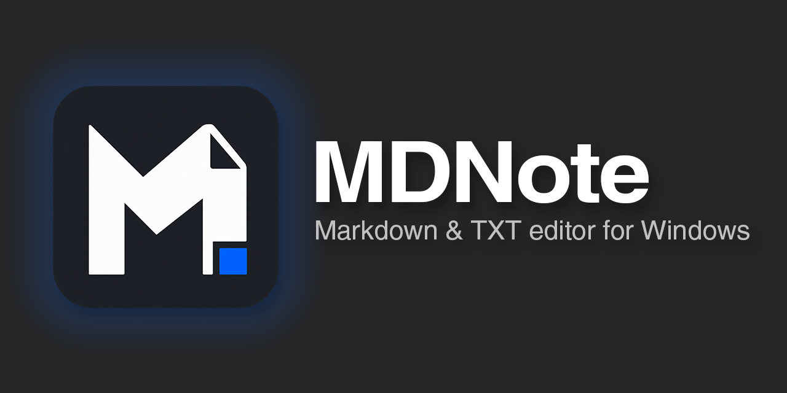
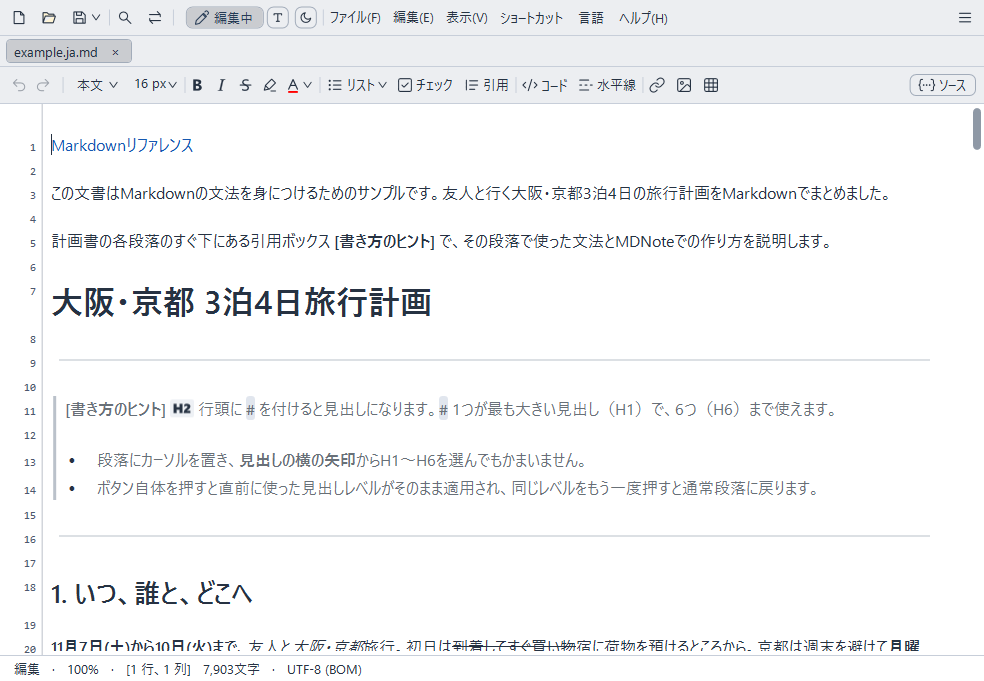
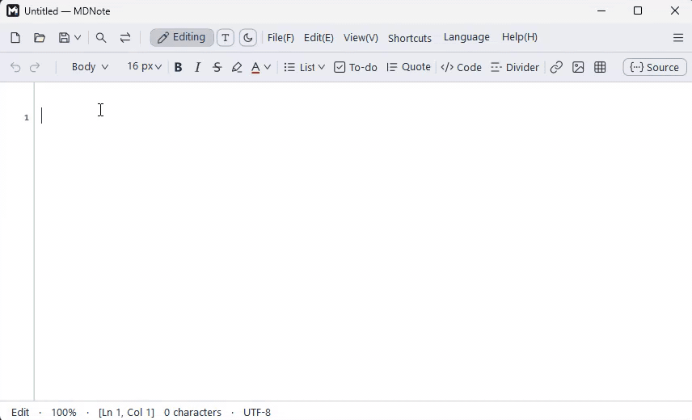
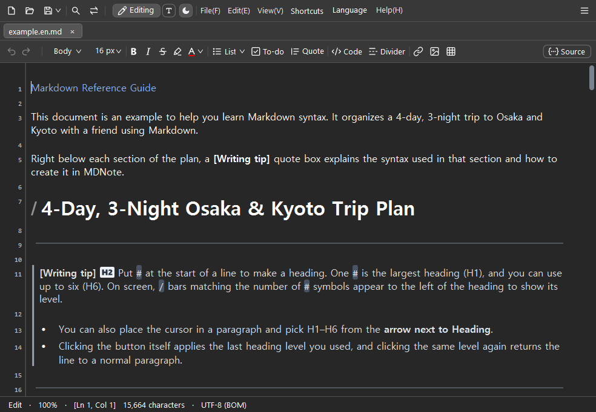
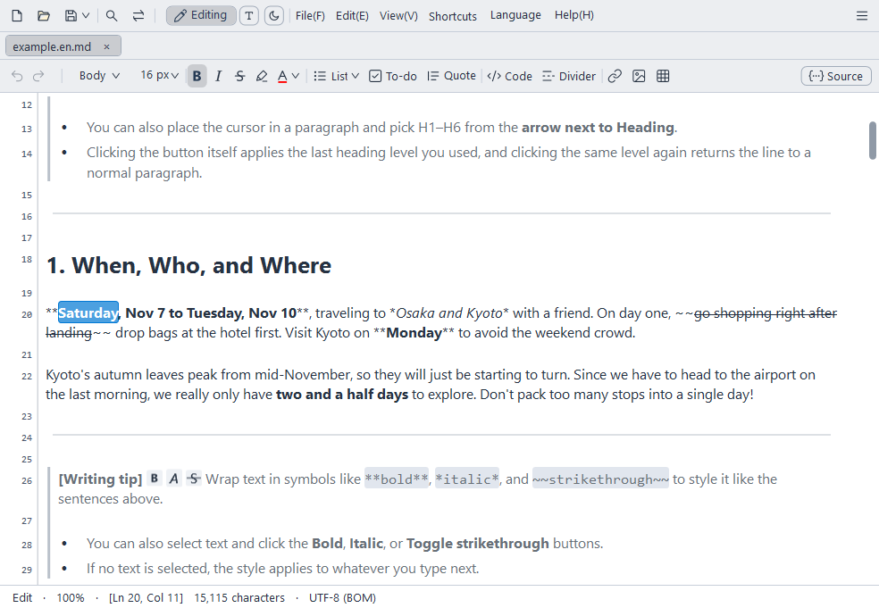
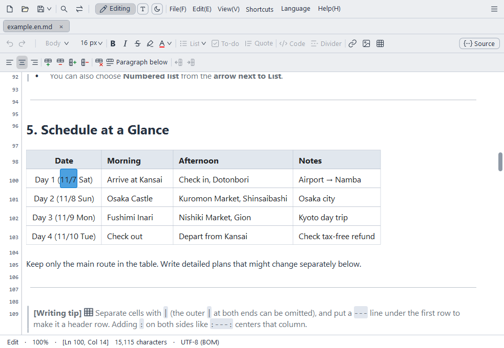
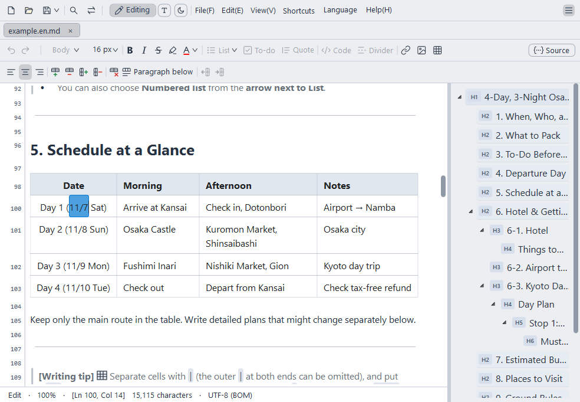
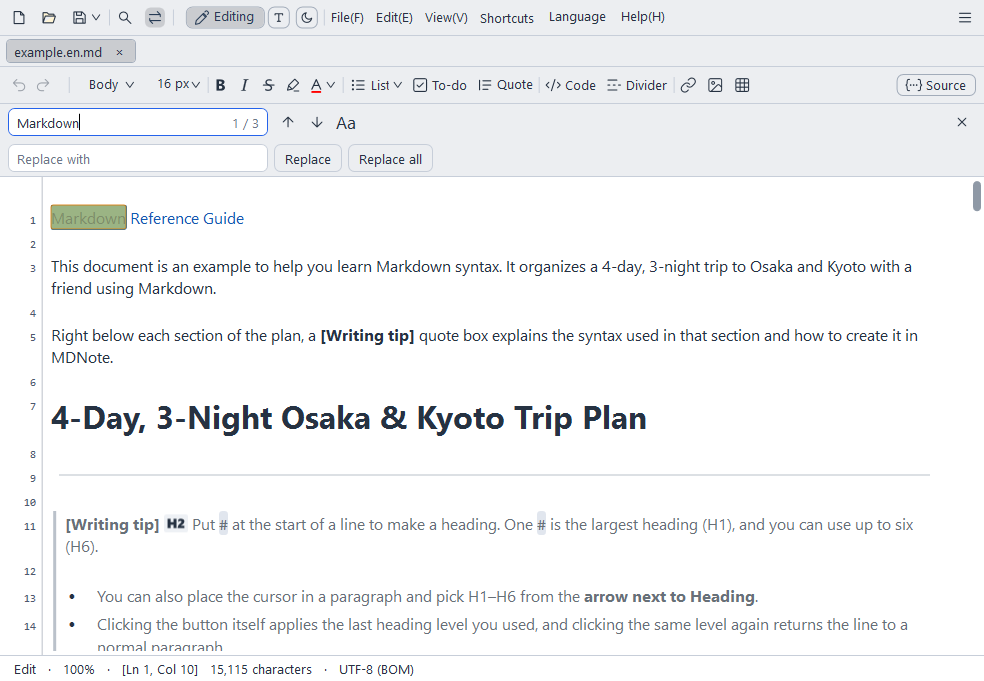
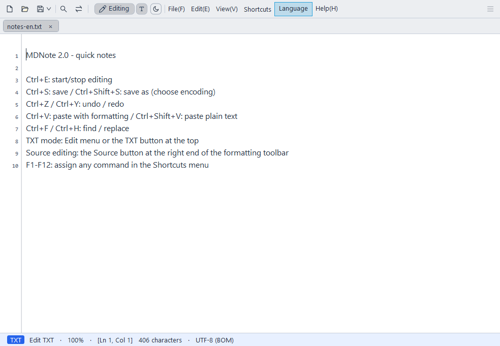
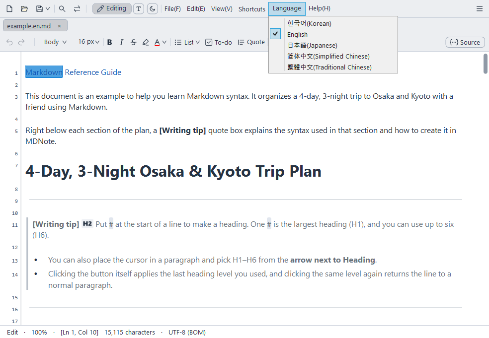

[English](README.md) · [한국어](README.ko.md) · **日本語** · [简体中文](README.zh-CN.md) · [繁體中文](README.zh-TW.md)

メモ帳のように軽くて速い、Windows用のMarkdown・TXTエディターです。

## MDNoteの強み

- **記号を知らなくても書けるMarkdown**: Wordのように見える画面でそのまま書けば、ファイルは標準的なMarkdownとして保存されます。
- **メモ帳のように軽く、大きな文書も高速に**: インストーラーは約1.3MB。数百万字の文書もすぐに開き、入力が遅れません。
- **MDとTXTを1つのソフトで**: TXTは行番号付きのメモ帳のように、MDは書式が見える文書のように扱えます。複数の文字コードで開いて保存できます。
- **日本語・韓国語・中国語の入力に強い**: 日本語や韓国語・中国語を入力するときも、文字が崩れたりカーソルが飛んだりしません。
- **書いた文章を失わないために**: 保存せずに終了しても次回起動時に復元し、保存中にエラーが発生しても元のファイルが破損しないよう保護します。
- **無料のオープンソース**: GPL v3ライセンスの下で、誰でも利用・改変できます。





## ダウンロード

[最新版をダウンロード (Releases)](https://github.com/Lahai-Roi/MDNote/releases/latest)

- `MDNote-Setup-2.0.1.exe`: インストーラーです。最初の画面で言語を選択します。
- `MDNote-2.0.1-portable.zip`: インストール不要のポータブル版です。展開して `MDNote.exe` を実行してください。
- Windows 10/11 64ビット、.NET Framework 4.8（Windowsに標準搭載）が必要です。
- 実行ファイルにデジタル署名がないため、初回起動時にWindowsの警告が表示されることがあります。**詳細情報 → 実行** をクリックしてください。

## 主な機能

- **書式そのまま編集**: `#` や `**` などの記号を隠し、見た目通りに文章を書けます。記号を見ながら書きたい場合は、**ライブモード**（カーソルのある行だけソースを表示）や **ソース** 編集に切り替えられます。
- **書式ツールバー**: 見出し、太字・斜体・取り消し線、文字色、リスト・チェックリスト、引用、コード挿入（1行・段落）、リンク、画像、表をボタンで挿入できます。
- **表の編集**: セル内に直接入力でき、行・列の追加や削除、配置の調整をツールバーで行えます。
- **TXTモード**: 行番号付きのプレーンテキスト編集です。MDをTXTに変換すると、書式記号を取り除いて表示されている文字だけを残します。
- **タブとウィンドウ、アウトライン**: 複数の文書をタブや新しいウィンドウで開き、見出し一覧から素早く移動できます。
- **検索・置換、印刷、文字コード**: UTF-8・UTF-16・CP949・Shift JIS・GBK・Big5などで開いて保存できます。
- **ダークモード、フォント・行間、F1〜F12ショートカット設定**: 表示設定やショートカットキーを好みに合わせて変更できます。
- **5言語に対応**: 한국어、English、日本語、简体中文、繁體中文に対応。ヘルプとサンプル文書も同じ言語で開きます。



## 画面で見る機能

| | |
|---|---|
| <br>**ライブモード**: カーソルのある行だけMarkdown記号が表示され、残りは書式通りに表示されます。 | <br>**表の編集**: セル内に直接入力でき、行・列の追加や配置はツールバーで行います。 |
| <br>**アウトライン**: 見出し一覧をクリックしてその位置へすぐに移動します。 | <br>**検索・置換**: 文書内の文字を検索し、一括で置換します。 |
| <br>**TXTモード**: 行番号付きのメモ帳のようにプレーンテキストを書けます。 | <br>**5言語**: メニュー・ヘルプ・サンプルが選択した言語に切り替わります。 |

## 使い方

アプリの **ヘルプ** メニューに2つの文書があります。

- **MDファイルの書き方**: 見出し・リスト・表・画像・コードの書き方とサンプル
- **MDNoteの使い方**: メニュー・ショートカット・表示設定の全体説明

## 制限事項

- Windows専用です（Windows 10/11 64ビット）。
- 数式（LaTeX）やフローチャート（Mermaid）などの拡張記法は、図に変換せず入力した文字のまま表示します。
- 文書をHTMLにエクスポートする機能はありません。PDFとして保存するには、印刷メニューで「Microsoft Print to PDF」を選択してください。

## よくある質問

**保存したファイルを他のソフトでも開けますか？**
はい。ファイルは標準的なMarkdown（.md）またはプレーンテキスト（.txt）として保存されるため、他のエディターでもそのまま開けます。ただし、文字色のように標準のMarkdownにない書式はHTMLタグとして保存されます。

**Markdownの記号を直接見ながら書きたいです。**
**表示 → Markdown ライブプレビュー** をオンにすると、カーソルのある行だけ記号が表示されます。文書全体を記号とともに表示するには、右上の **ソース** ボタンを押します。

**太字の直後に続けて書くと、太字のままになりますか？**
いいえ。太字が終わった位置から続けて書くと通常の文字になり、太字の内側で書くと太字で入力されます。

**初回起動時にWindowsの警告が表示されます。**
実行ファイルにデジタル署名がないためです。**詳細情報 → 実行** を押してください。

**インストールせずに使えますか？**
はい。`MDNote-2.0.1-portable.zip` を展開し、`MDNote.exe` を実行してください。

**アンインストールするにはどうすればいいですか？**
インストーラー版は、Windowsの設定のアプリ一覧からアンインストールします。インストールフォルダに手動で入れたファイルがある場合は、そのファイルだけが残ります。ポータブル版は、展開したフォルダを削除するだけです。

## プライバシー

- MDNoteはインターネットに接続しません。使用履歴や文書の内容を外部に送信することはありません。
- 未保存の文章を復元するため、編集中の内容のコピーをPCのユーザーフォルダ（AppData）にのみ保存します。保存するか閉じると削除されます。
- 設定（フォント、言語、ショートカットなど）もご自身のPCにのみ保存されます。

## バグ報告と提案

[Issues](https://github.com/Lahai-Roi/MDNote/issues) にお寄せください。以下の内容を一緒に書いていただくと、より早く修正できます。

- 何をしたときに（押したメニュー・キー、入力した文字）どうなったか、本来どうなるべきか
- Windowsのバージョン、使用しているIME（日本語・韓国語・中国語など）
- 可能であればスクリーンショット。プライベートな文書の内容は載せないでください。

## ソースからビルド

Windows付属の .NET Framework 4.8 C# コンパイラでビルドします。Visual Studioは不要です。

```powershell
.\src\build.ps1
```

`src` フォルダ内に `MDNote.exe` が作成されます。

インストーラーは [NSIS 3](https://nsis.sourceforge.io/) で作成します。手順は [src/installer/README.md](src/installer/README.md) をご覧ください。

## ライセンス

MDNoteは [GNU General Public License v3.0](LICENSE) の下で配布されています。
改変した [AvalonEdit](https://github.com/icsharpcode/AvalonEdit)（MITライセンス）を含みます。詳細は [THIRD_PARTY_NOTICES.txt](src/THIRD_PARTY_NOTICES.txt) をご覧ください。

Copyright (c) 2026 Lahai-Roi
