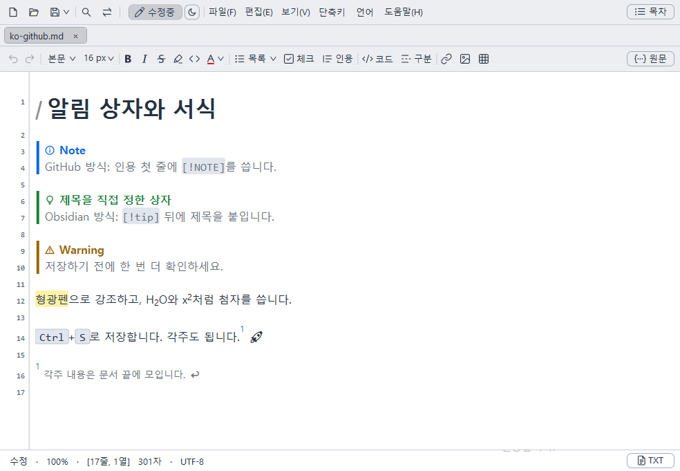
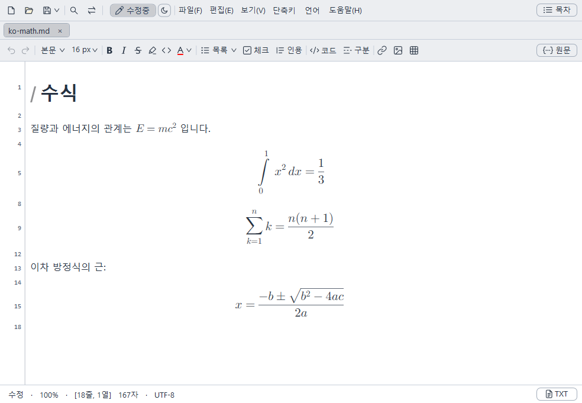

[English](README.md) · **한국어** · [日本語](README.ja.md) · [简体中文](README.zh-CN.md) · [繁體中文](README.zh-TW.md)

메모장처럼 가볍고 빠른 Windows용 Markdown·TXT 편집기입니다.

## MDNote의 강점

- **기호를 몰라도 되는 Markdown**: 워드처럼 보이는 화면에서 그대로 쓰면, 파일은 표준 Markdown으로 저장됩니다.
- **메모장만큼 가볍게, 큰 문서도 빠르게**: 설치 파일 크기는 약 1.3MB입니다. 수백만 자의 문서도 바로 열리고 입력이 밀리지 않습니다.
- **MD와 TXT를 한 프로그램에서**: TXT는 줄 번호가 보이는 메모장처럼, MD는 서식이 보이는 문서처럼 씁니다. 여러 인코딩으로 열고 저장합니다.
- **쓴 글을 잃지 않게**: 저장하지 않고 꺼져도 다음 실행 때 복구하고, 저장하는 도중에 오류가 나도 원래 파일이 손상되지 않게 보호합니다.
- **무료 오픈 소스**: GPL v3 라이선스로 누구나 쓰고 고칠 수 있습니다.


## 내려받기

[최신 버전 내려받기(Releases)](https://github.com/Lahai-Roi/MDNote/releases/latest)

- 설치 파일(`MDNote-Setup-<버전>.exe`): 설치 첫 화면에서 언어를 고릅니다.
- 설치 없이 쓰는 파일(`MDNote-<버전>-portable.zip`): 압축을 풀고 `MDNote.exe`를 실행합니다.
- Windows 10/11 64비트, .NET Framework 4.8(Windows에 기본으로 들어 있음)이 필요합니다.
- 실행 파일에 디지털 서명이 없어 처음 실행할 때 Windows가 경고를 띄울 수 있습니다. **추가 정보 → 실행**을 누르면 됩니다.

## 주요 기능

- **보이는 대로 편집**: `#`, `**` 같은 기호를 숨기고 서식대로 씁니다. 기호가 필요하면 **라이브 모드**나 **원문**으로 봅니다.
- **도구 줄과 표 편집**: 제목·굵게·글자색·목록·코드·링크·이미지·표를 버튼으로 넣고, 표는 칸 안에서 바로 고칩니다.
- **GitHub 서식과 수식**: 알림 상자(GitHub·Obsidian 방식), 형광펜, 각주, `[TOC]`, 이모지, 수식(`$E=mc^2$`)이 화면에 그대로 보입니다.
- **TXT 모드**: 줄 번호가 보이는 메모장처럼 일반 텍스트를 씁니다.
- **탭·창·목차**: 여러 문서를 탭이나 새 창으로 열고, 제목 목록과 같은 폴더의 파일 목록으로 이동합니다.
- **그림 정리**: 붙여 넣거나 끌어 놓은 그림을 저장할 때 문서 옆 폴더에 모아 둡니다.
- **찾기·바꾸기, 인쇄, HTML 저장, 여러 인코딩**(UTF-8·CP949·Shift JIS·GBK·Big5 등)
- **이전 세션 이어 쓰기, 파일 변경 알림**
- **다크·집중·타자기 모드, 단축키 지정, 5개 언어(영어, 한국어, 일본어, 중어간체, 중어번체)**


## 화면으로 보는 기능

| | |
|---|---|
| <br>**라이브 모드**: 커서가 있는 줄만 Markdown 기호가 보이고, 나머지는 서식대로 보입니다. | <br>**표 편집**: 칸 안에서 바로 쓰고, 행·열 추가와 정렬은 도구 줄로 합니다. |
| <br>**목차**: 제목 목록을 눌러 그 위치로 바로 이동합니다. | <br>**찾기·바꾸기**: 문서 안 글자를 찾고 한꺼번에 바꿉니다. |
| <br>**TXT 모드**: 줄 번호가 보이는 메모장처럼 일반 텍스트를 씁니다. | <br>**5개 언어**: 메뉴·도움말·예제가 고른 언어로 바뀝니다. |
| <br>**알림 상자와 서식**: GitHub 알림 상자와 제목을 직접 정하는 Obsidian식 상자, 형광펜·각주·키 표시를 보여 줍니다. | <br>**수식**: 문장 속 `$…$`와 따로 줄에 쓴 `$$…$$`를 수식으로 보여 줍니다. |

## 사용법

앱의 **도움말** 메뉴에 두 문서가 있습니다.

- **MD파일 작성방법**: 제목·목록·표·이미지·코드를 쓰는 방법과 예제
- **MDNote 사용법**: 메뉴·단축키·보기 설정 전체 설명

## 한계

- Windows 전용입니다(Windows 10/11 64비트).
- 순서도(Mermaid) 같은 확장 문법은 그림으로 바꾸지 않고 적은 글자 그대로 보여 줍니다.
- PDF로 저장하려면 인쇄 메뉴에서 'Microsoft Print to PDF'를 고르면 됩니다.

## 자주 묻는 질문

**저장한 파일을 다른 프로그램에서도 열 수 있나요?**
네. 파일은 표준 Markdown(.md) 또는 일반 텍스트(.txt)로 저장되므로 다른 편집기에서도 그대로 열립니다. 다만 글자색처럼 표준 Markdown에 없는 서식은 HTML 태그로 저장됩니다.

**Markdown 기호를 직접 보면서 쓰고 싶어요.**
**보기 → Markdown 라이브 미리보기**를 켜면 커서가 있는 줄만 기호가 보입니다. 문서 전체를 기호와 함께 보려면 오른쪽 위 **원문** 버튼을 누릅니다.

**처음 실행할 때 Windows가 경고를 띄워요.**
실행 파일에 디지털 서명이 없어서 그렇습니다. **추가 정보 → 실행**을 누르면 됩니다.

**설치하지 않고 쓸 수 있나요?**
네. 최신 릴리스에서 `-portable.zip`으로 끝나는 파일을 내려받아 풀고 `MDNote.exe`를 실행하면 됩니다.

**지우려면 어떻게 하나요?**
설치 버전은 Windows 설정의 앱 목록에서 제거합니다. 설치 폴더에 직접 넣은 파일이 있으면 그 파일만 남습니다. 무설치 버전은 압축을 푼 폴더를 지우면 됩니다.

## 개인정보

- MDNote는 기본 설정에서는 인터넷에 연결하지 않습니다. **도움말 → 업데이트 확인**을 누를 때와 **업데이트 자동 확인**을 켰을 때(기본 꺼짐, 프로그램을 실행할 때마다)만 GitHub에서 최신 버전 번호를 확인합니다. 사용 기록이나 문서 내용은 어디에도 보내지 않습니다.
- 저장하지 않은 글을 복구하기 위해, 편집 중인 내용의 사본을 내 PC의 사용자 폴더(AppData)에만 둡니다. 저장하거나 닫으면 지워집니다.
- 설정(글꼴, 언어, 단축키 등)도 내 PC에만 저장됩니다.

## 버그 신고와 제안

[Issues](https://github.com/Lahai-Roi/MDNote/issues)에 남겨 주세요. 다음을 함께 적어 주시면 빨리 고칠 수 있습니다.

- 무엇을 했을 때(누른 메뉴·키, 입력한 글자) 어떻게 되었는지, 원래 어떻게 되어야 하는지
- Windows 버전, 쓰는 입력기(한국어·일본어·중국어 등)
- 가능하면 화면 사진. 개인적인 문서 내용은 올리지 마세요.

## 소스에서 빌드하기

Windows의 .NET Framework 4.8 C# 컴파일러로 빌드합니다. Visual Studio는 없어도 됩니다.

```powershell
.\src\build.ps1
```

`src` 폴더 안에 `MDNote.exe`가 만들어집니다.

설치 파일은 [NSIS 3](https://nsis.sourceforge.io/)로 만듭니다. 방법은 [src/installer/README.md](src/installer/README.md)에 있습니다.

## 라이선스

MDNote는 [GNU General Public License v3.0](LICENSE)으로 배포합니다.
수정한 [AvalonEdit](https://github.com/icsharpcode/AvalonEdit)(MIT 라이선스)을 포함합니다. 자세한 내용은 [THIRD_PARTY_NOTICES.txt](src/THIRD_PARTY_NOTICES.txt)를 보세요.

Copyright (c) 2026 Lahai-Roi
