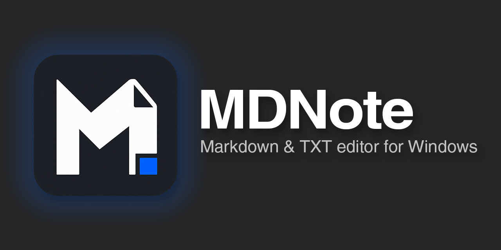
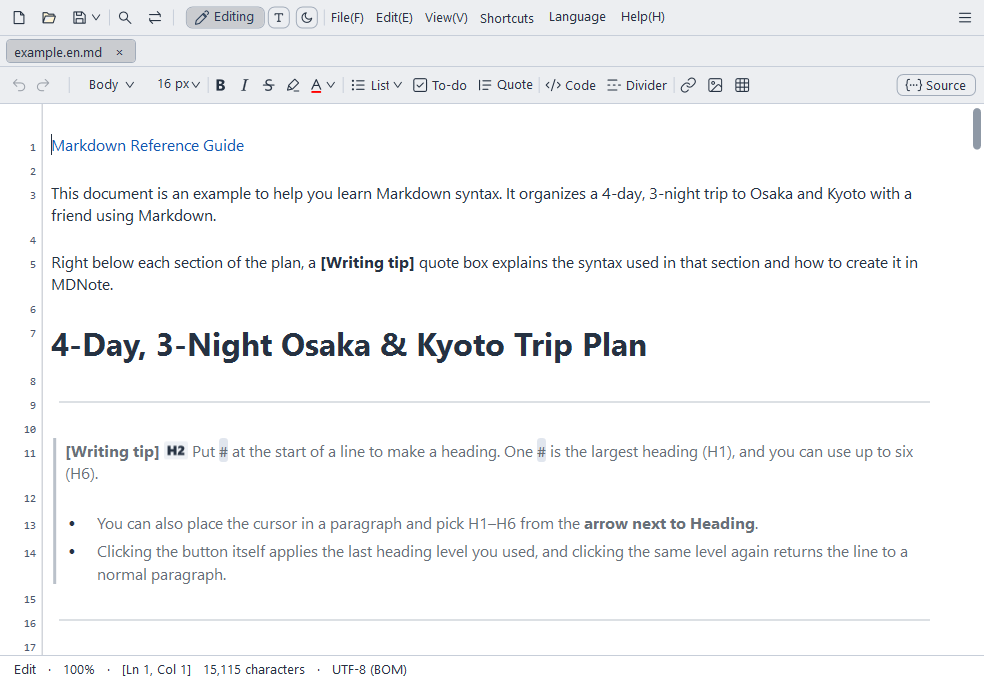
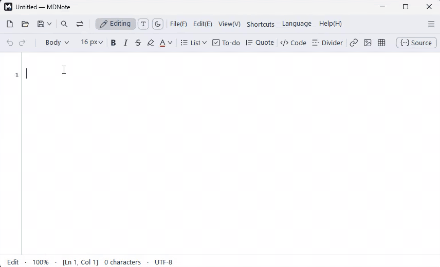
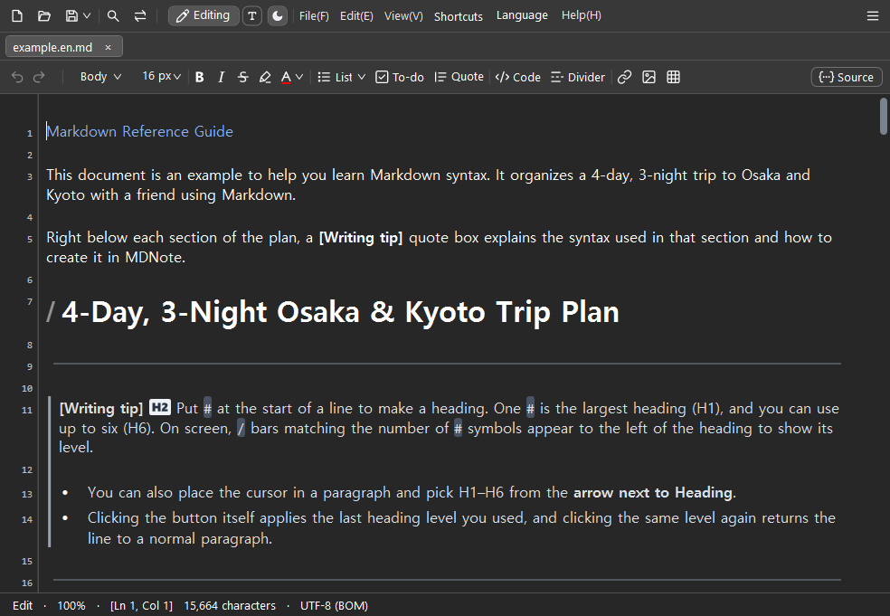
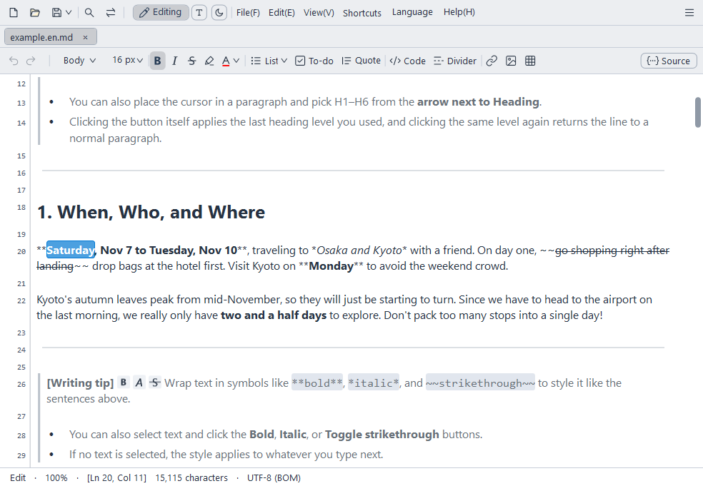
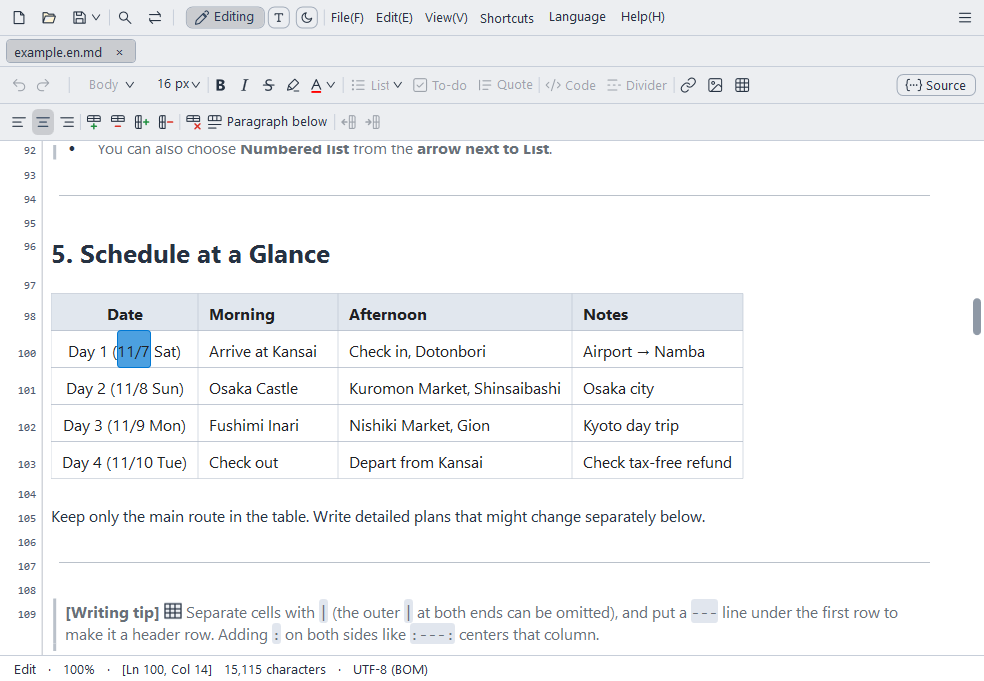
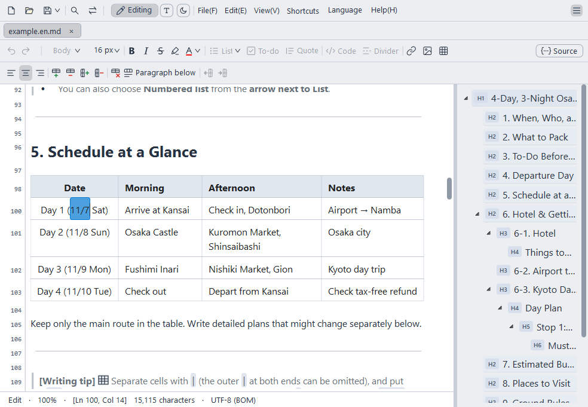
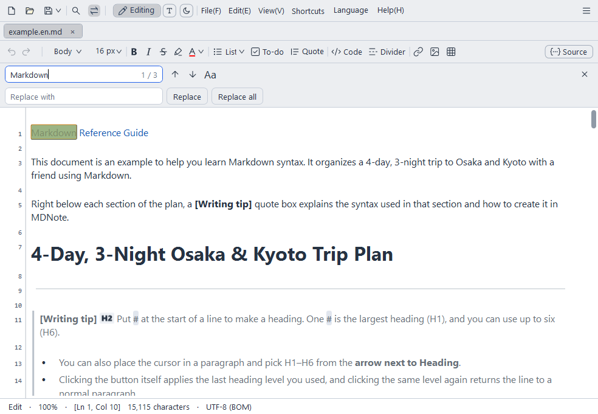
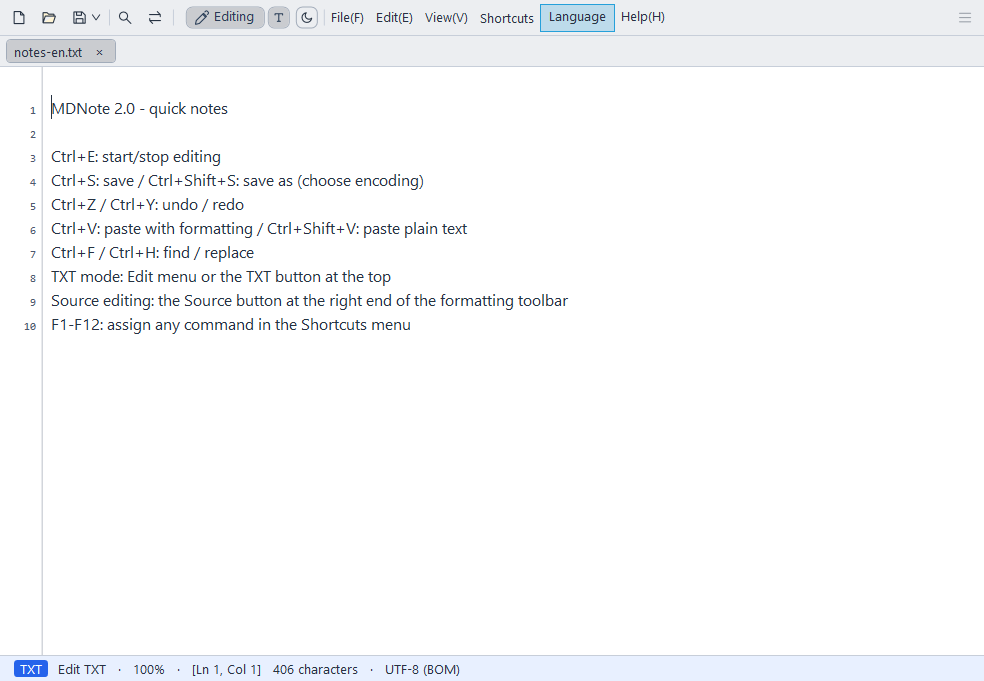
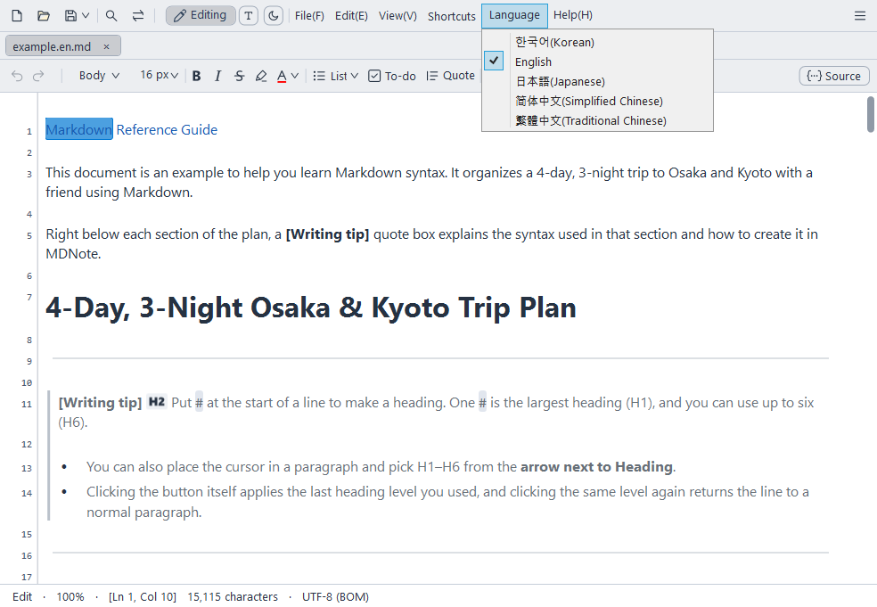

**English** · [한국어](README.ko.md) · [日本語](README.ja.md) · [简体中文](README.zh-CN.md) · [繁體中文](README.zh-TW.md)

A fast, lightweight Markdown and TXT editor for Windows—just like Notepad.

## Why MDNote

- **Markdown Without Memorizing Syntax**: Write directly in a Word-like formatted view while your files are saved as standard Markdown.
- **Lightweight Like Notepad, Fast with Large Files**: Around 1.3 MB installer. Opens documents with millions of characters right away with no typing lag.
- **MD and TXT in One App**: Edit TXT files like Notepad with line numbers, and MD files like formatted documents. Open and save in multiple encodings.
- **Reliable Korean, Japanese, and Chinese Input**: Characters don't break and the cursor doesn't jump when typing Korean, Japanese, or Chinese.
- **Keep Your Work Safe**: Recovers unsaved text on the next launch after an unexpected exit, and protects the original file from corruption even if an error occurs while saving.
- **Free and Open Source**: Released under the GPL v3 license for anyone to use and modify.





## Download

[Download Latest Release (Releases)](https://github.com/Lahai-Roi/MDNote/releases/latest)

- `MDNote-Setup-2.2.1.exe`: Installer. Choose your language on the first screen of the setup.
- `MDNote-2.2.1-portable.zip`: Portable version (no installation required). Extract the ZIP and run `MDNote.exe`.
- Requires Windows 10/11 64-bit and .NET Framework 4.8 (pre-installed on Windows).
- Because the executable is not digitally signed, Windows may show a warning on first launch. Click **More info → Run anyway**.

## Key Features

- **Edit as Formatted**: Hide symbols like `#` and `**` and write directly as the document appears. If you prefer to see the symbols while typing, switch to **Live mode** (shows raw syntax only on the active line) or **Source** editing.
- **Formatting Toolbar**: Insert headings, bold, italic, strikethrough, text color, lists & checklists, blockquotes, code (inline & block), links, images, and tables with a click.
- **Table Editing**: Type directly inside cells, and add, remove, or align rows and columns using the toolbar.
- **TXT mode**: Plain text editing with line numbers. Converting MD to TXT strips formatting symbols and keeps only the visible text.
- **Tabs, Windows, and Outline**: Open multiple documents in tabs or new windows, and jump to sections using the heading list.
- **Insert images**: Whether added via paste, drag-and-drop, or the image button, images remaining in the document upon saving are collected into an adjacent folder of the same name and linked.
- **Continue previous session**: When on, closes unsaved documents without prompting and resumes them right where you left off the next time you open MDNote.
- **Find & Replace, Print, Encodings**: Find with regular expressions if you like. Open and save files in UTF-8, UTF-16, CP949, Shift JIS, GBK, Big5, and more.
- **Save as HTML**: Choose **HTML files (*.html)** in **Save as…** to create a separate .html file that opens in a browser and can be pasted into blogs or email.
- **Math formulas**: `$E=mc^2$` in a sentence and `$$ … $$` on their own lines are shown as formulas.
- **Focus mode & Typewriter mode**: Keep only the current paragraph or line clear, or keep the line you are typing in the middle of the window. Both are off by default.
- **File change alerts**: If another program changes or deletes an open file, MDNote asks whether to reload it. It also asks before saving over a file that was changed elsewhere.
- **Dark mode, Font & Line Spacing, F1–F12 Shortcuts**: Customize display settings and function key shortcuts to your liking.
- **5 Languages**: Supports 한국어, English, 日本語, 简体中文, and 繁體中文. Help guides and sample documents open in the selected language.



## Features at a Glance

| | |
|---|---|
| <br>**Live mode**: Shows Markdown symbols only on the line where the cursor is, while the rest stays formatted. | <br>**Table Editing**: Type directly inside cells, and add or align rows and columns using the toolbar. |
| <br>**Outline**: Click a heading in the list to jump straight to that section. | <br>**Find & Replace**: Find text in the document and replace it all at once. |
| <br>**TXT mode**: Write plain text with line numbers, just like Notepad. | <br>**5 Languages**: Menus, help guides, and sample documents switch to the selected language. |

## How to Use

Two guides are available under the **Help** menu in the app:

- **Writing Markdown**: How to write headings, lists, tables, images, and code, with examples
- **Using MDNote**: Full guide to menus, shortcuts, and view settings

## Limitations

- Windows only (Windows 10/11 64-bit).
- Flowcharts (Mermaid) are not rendered as graphics and are shown as plain text.
- To save as a PDF, select 'Microsoft Print to PDF' in the Print menu.

## FAQ

**Can I open saved files in other programs?**
Yes. Files are saved as standard Markdown (.md) or plain text (.txt), so they open as-is in other editors. However, formatting not in standard Markdown, such as text color, is saved as HTML tags.

**I want to see the Markdown symbols while writing.**
Turn on **View → Markdown Live Preview** to see symbols only on the line where the cursor is. To view the entire document with symbols, click the **Source** button at the top right.

**If I keep typing right after bold text, does it stay bold?**
Yes. Typing right after the end of bold text keeps it bold, just as the Bold button shows. After a space, you type normal text.

**Windows shows a warning when I run it for the first time.**
This is because the executable is not digitally signed. Click **More info → Run anyway**.

**Can I use it without installing?**
Yes. Extract `MDNote-2.2.1-portable.zip` and run `MDNote.exe`.

**How do I uninstall it?**
For the installed version, uninstall it from the Apps list in Windows Settings. If you manually placed any files in the installation folder, only those files will remain. For the portable version, simply delete the extracted folder.

## Privacy

- By default, MDNote does not connect to the internet. It checks the latest version number on GitHub only when you select **Help → Check for updates**, or once a day if you turn on **Check for updates automatically** (off by default). It never sends usage logs or document contents anywhere.
- To recover unsaved text, a copy of the content being edited is kept only in your PC's user folder (AppData). It is deleted when you save or close the document.
- Settings (font, language, shortcuts, etc.) are also saved only on your PC.

## Bug Reports & Suggestions

Please leave them on [Issues](https://github.com/Lahai-Roi/MDNote/issues). Including the following details will help us fix the issue faster:

- What you did (menus or keys pressed, characters typed), what happened, and what was supposed to happen
- Your Windows version and IME (Korean, Japanese, Chinese, etc.)
- A screenshot if possible. Please do not include private document contents.

## Building from Source

Builds with the .NET Framework 4.8 C# compiler included in Windows. Visual Studio is not required.

```powershell
.\src\build.ps1
```

`MDNote.exe` will be created in the `src` folder.

The installer is built with [NSIS 3](https://nsis.sourceforge.io/). See [src/installer/README.md](src/installer/README.md) for instructions.

## License

MDNote is distributed under the [GNU General Public License v3.0](LICENSE).
Includes a modified version of [AvalonEdit](https://github.com/icsharpcode/AvalonEdit) (MIT License). See [THIRD_PARTY_NOTICES.txt](src/THIRD_PARTY_NOTICES.txt) for details.

Copyright (c) 2026 Lahai-Roi
