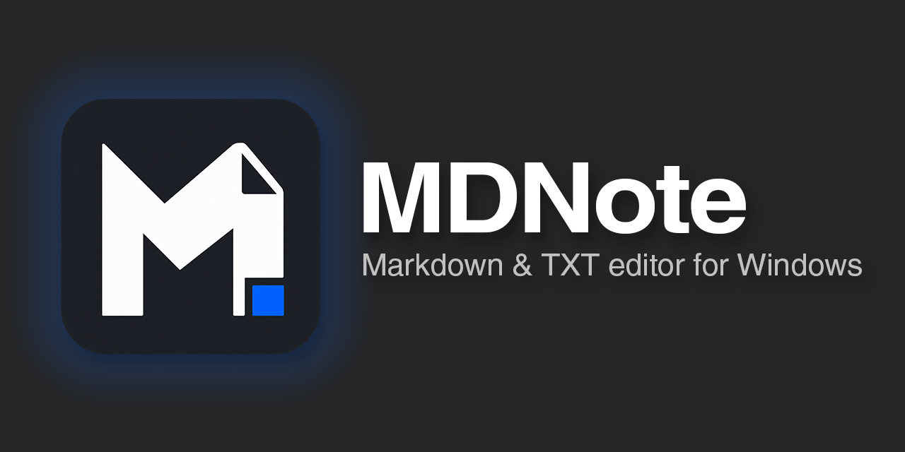
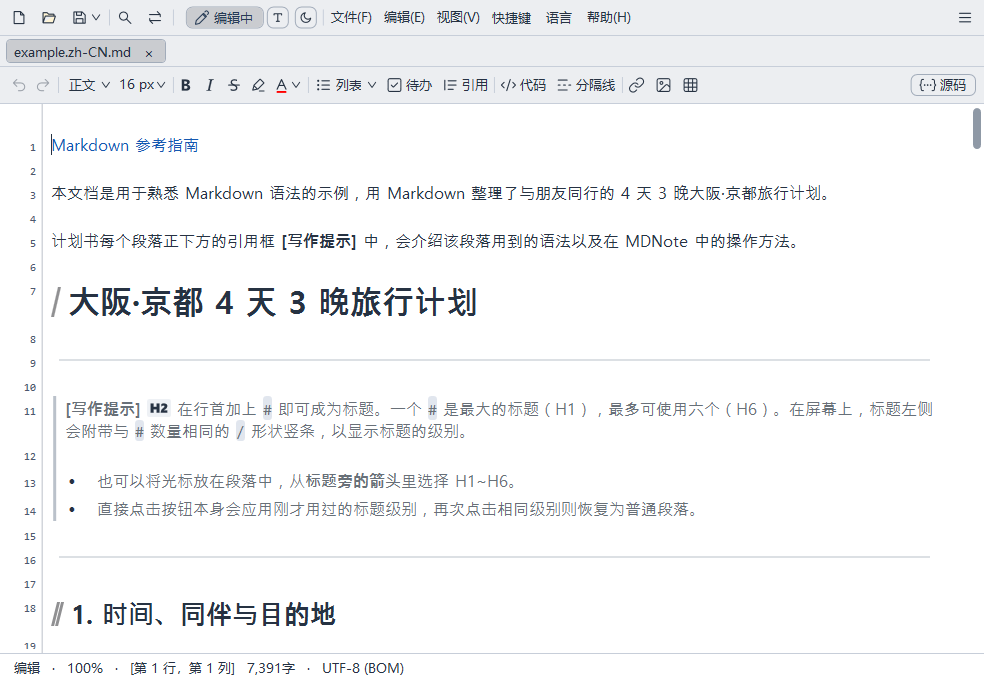
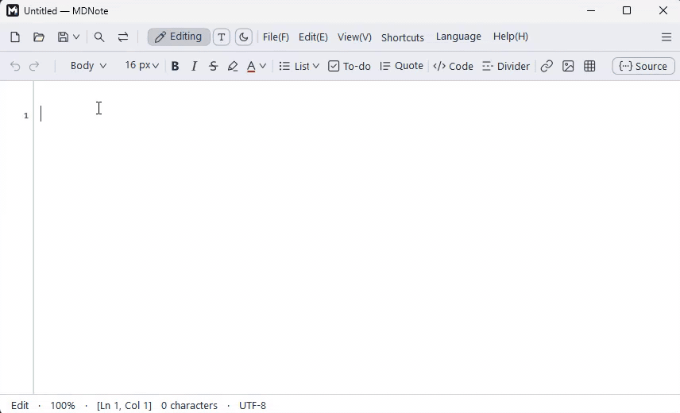
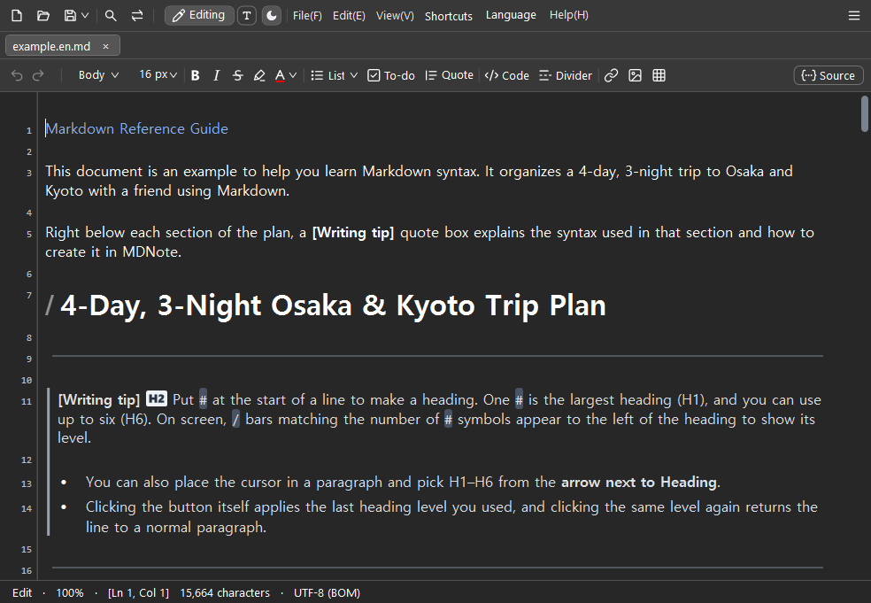
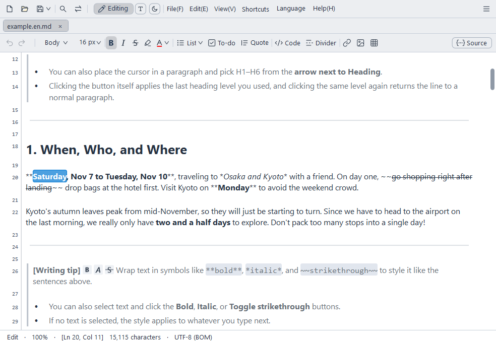
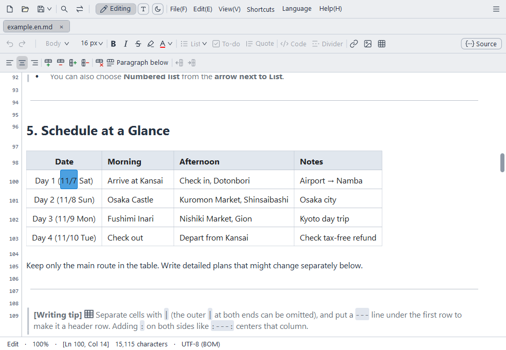
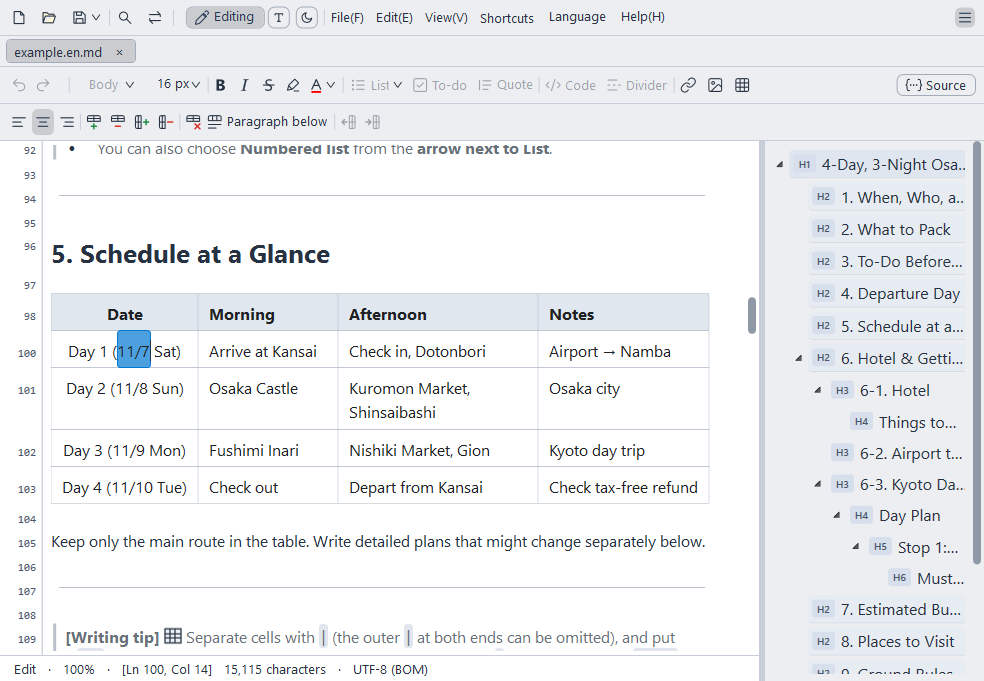
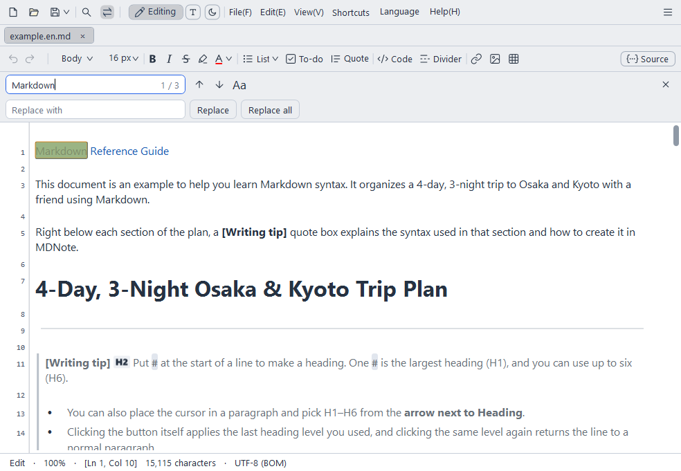
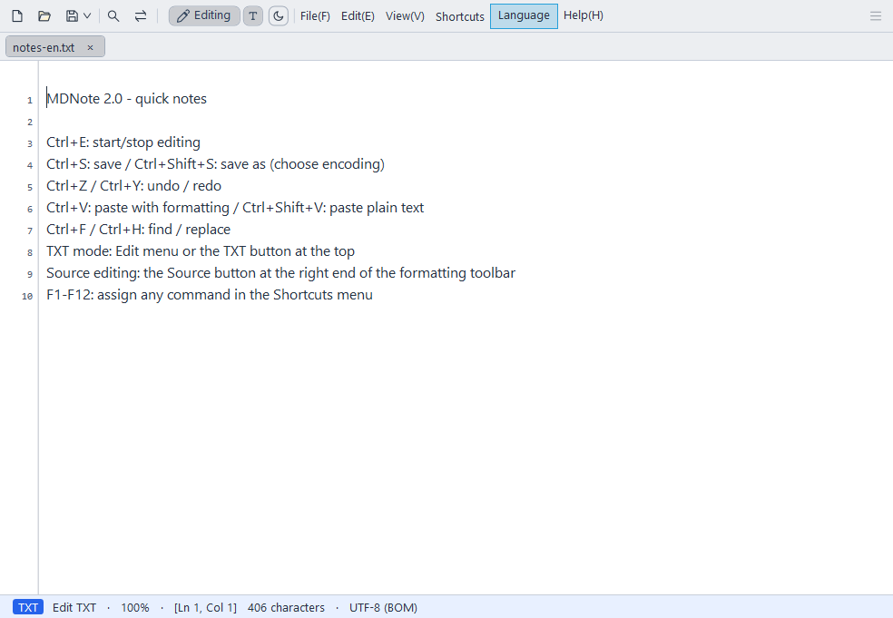
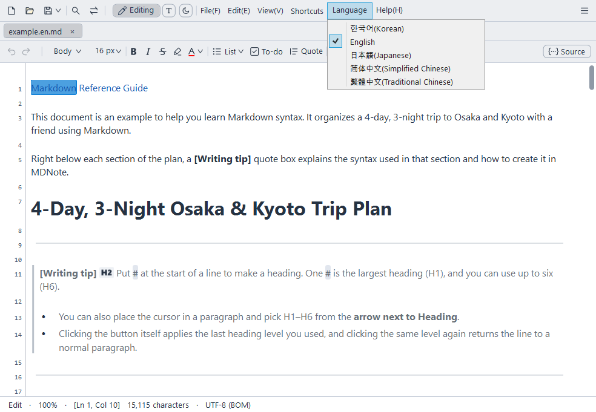

[English](README.md) · [한국어](README.ko.md) · [日本語](README.ja.md) · **简体中文** · [繁體中文](README.zh-TW.md)

像记事本一样轻快敏捷的 Windows Markdown 与 TXT 编辑器。

## MDNote 的优势

- **无需记住符号的 Markdown**：在类似 Word 的排版界面中直接写作，文件会保存为标准 Markdown 格式。
- **如记事本般轻巧，大文档同样快速**：安装包约 1.3MB。数百万字的文档也能立即打开，打字不卡顿。
- **一个程序兼顾 MD 与 TXT**：TXT 可像带行号的记事本一样编辑，MD 可像带排版的文档一样写作，支持多种编码打开和保存。
- **对中、日、韩输入法友好**：输入中文、日文或韩文时，不会出现乱码或光标乱跳的情况。
- **防止内容丢失**：即使未保存意外退出，下次启动时也能恢复；即使保存过程中出错，也会保护原文件不受损坏。
- **免费开源**：基于 GPL v3 许可证发布，任何人都可以自由使用和修改。





## 下载

[下载最新版本 (Releases)](https://github.com/Lahai-Roi/MDNote/releases/latest)

- `MDNote-Setup-2.2.1.exe`：安装程序。可在安装首个界面选择语言。
- `MDNote-2.2.1-portable.zip`：免安装便携版。解压后直接运行 `MDNote.exe`。
- 需要 Windows 10/11 64 位与 .NET Framework 4.8（Windows 系统自带）。
- 由于程序未包含数字签名，首次运行时 Windows 可能会弹出安全提示，点击 **更多信息 → 仍要运行** 即可。

## 主要功能

- **所见即所得编辑**：隐藏 `#`、`**` 等符号，按实际排版效果直接写作。如果想边看符号边写，可切换为**实时模式**（仅光标所在行显示源码）或**源码**编辑。
- **格式工具栏**：通过按钮一键插入标题、粗体、斜体、删除线、文字颜色、列表与任务列表、引用、插入代码（单行与段落）、链接、图片和表格。
- **表格编辑**：直接在单元格内输入，使用工具栏增删行列与调整对齐方式。
- **TXT 模式**：带行号的纯文本编辑模式。将 MD 转为 TXT 时，会自动清除格式符号，仅保留可见文字。
- **标签页、多窗口与大纲**：支持在标签页或新窗口中打开多个文档，并通过标题列表快速跳转。
- **插入图片**：无论是通过粘贴、拖放还是图片按钮添加，保存时都会将文档中保留的图片收集到同级同名文件夹中并生成链接。
- **继续上一个会话**：开启后，未保存的文档也会不经提示直接关闭，并在下次打开时直接恢复继续编辑。
- **查找替换、打印与编码**：查找时可使用正则表达式。支持以 UTF-8、UTF-16、CP949、Shift JIS、GBK、Big5 等编码打开和保存。
- **保存为 HTML**：在**另存为…**中选择 **HTML 文件 (*.html)**，即可另外生成可在浏览器中打开或粘贴到博客、邮件中的 .html 文件。
- **公式显示**：句子中的 `$E=mc^2$` 和单独成行的 `$$ … $$` 会显示为公式。
- **专注模式与打字机模式**：只清晰显示光标所在的段落或行，或让正在输入的行保持在窗口中间。两者默认均为关闭。
- **文件变更提醒**：已打开的文件被其他程序修改或删除时，会询问是否重新载入；保存到被其他程序修改过的文件前也会先询问。
- **深色模式、字体与行距、F1~F12 快捷键自定义**：可根据个人习惯调整显示设置与快捷键。
- **5 种语言**：支持 한국어、English、日本語、简体中文、繁體中文，帮助文档与示例文档也会以所选语言打开。



## 界面功能预览

| | |
|---|---|
| <br>**实时模式**：仅光标所在行显示 Markdown 符号，其余部分按排版效果显示。 | <br>**表格编辑**：直接在单元格内输入，使用工具栏添加行列与调整对齐。 |
| <br>**大纲**：点击标题列表即可直接跳转到对应位置。 | <br>**查找替换**：查找文档中的文字并一次性全部替换。 |
| <br>**TXT 模式**：像带行号的记事本一样编辑纯文本。 | <br>**5 种语言**：菜单、帮助与示例文档均会切换为所选语言。 |

## 使用方法

应用的**帮助**菜单中包含两份文档：

- **MD文件编写方法**：标题、列表、表格、图片、代码的编写方法与示例
- **MDNote使用说明**：菜单、快捷键与视图设置的完整说明

## 局限性

- 仅支持 Windows（Windows 10/11 64 位）。
- 流程图（Mermaid）等扩展语法不会渲染为图形，而是直接显示输入的原文字。
- 如需保存为 PDF，请在打印菜单中选择“Microsoft Print to PDF”。

## 常见问题

**保存的文件可以用其他程序打开吗？**
可以。文件会保存为标准 Markdown（.md）或纯文本（.txt），因此在其他编辑器中也能正常打开。不过，像文字颜色这种标准 Markdown 中没有的格式，会保存为 HTML 标签。

**我想边看 Markdown 符号边写作。**
开启 **视图 → Markdown 实时预览** 后，仅光标所在行会显示符号。如果想让整个文档都显示符号，请点击右上角的**源码**按钮。

**紧接着粗体文字后面继续打字，还会是粗体吗？**
会。紧接着粗体末尾输入会与粗体按钮的状态一致，继续保持粗体；先输入空格再打字则为普通文字。

**首次运行时 Windows 弹出了警告。**
这是因为可执行文件没有数字签名。点击 **更多信息 → 仍要运行** 即可。

**可以不安装直接使用吗？**
可以。解压 `MDNote-2.2.1-portable.zip` 后运行 `MDNote.exe` 即可。

**如何卸载？**
安装版可在 Windows 设置的应用列表中卸载。如果安装文件夹中有您手动放入的文件，则只会保留这些文件。免安装便携版直接删除解压后的文件夹即可。

## 隐私说明

- MDNote 默认不连接互联网，仅在点击**帮助 → 检查更新**时，或开启**自动检查更新**后（默认关闭，每天一次），从 GitHub 检查最新版本号。不会向任何地方发送使用记录或文档内容。
- 为了恢复未保存的内容，正在编辑的内容副本仅保存在本机用户文件夹（AppData）中，保存或关闭文档后即会删除。
- 各项设置（字体、语言、快捷键等）也仅保存在您的电脑上。

## 错误反馈与建议

请在 [Issues](https://github.com/Lahai-Roi/MDNote/issues) 中留言。如果能一并提供以下信息，将有助于我们更快修复问题：

- 进行了什么操作（点击的菜单或按键、输入的文字）、发生了什么情况、原本应该是什么效果
- Windows 版本、使用的输入法（中文、日文、韩文等）
- 如有可能请附上截图。请勿上传包含个人隐私的文档内容。

## 从源码构建

使用 Windows 自带的 .NET Framework 4.8 C# 编译器即可构建，无需安装 Visual Studio。

```powershell
.\src\build.ps1
```

会在 `src` 文件夹中生成 `MDNote.exe`。

安装程序使用 [NSIS 3](https://nsis.sourceforge.io/) 制作，具体步骤请参考 [src/installer/README.md](src/installer/README.md)。

## 许可证

MDNote 基于 [GNU General Public License v3.0](LICENSE) 发布。
包含修改后的 [AvalonEdit](https://github.com/icsharpcode/AvalonEdit)（MIT 许可证）。详情请参阅 [THIRD_PARTY_NOTICES.txt](src/THIRD_PARTY_NOTICES.txt)。

Copyright (c) 2026 Lahai-Roi
