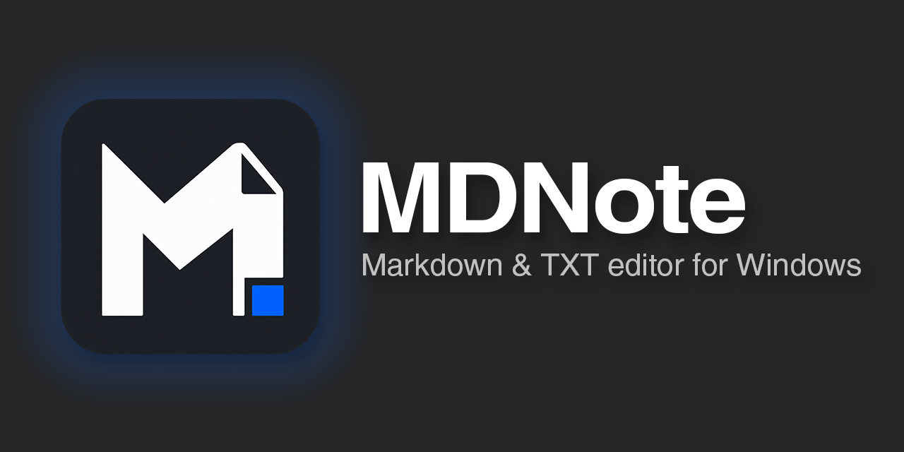

[English](README.md) · [한국어](README.ko.md) · [日本語](README.ja.md) · [简体中文](README.zh-CN.md) · **繁體中文**

像記事本一樣輕巧快速的 Windows Markdown 與 TXT 編輯器。

## MDNote 的優勢

- **不必記語法符號的 Markdown**：在像 Word 一樣的畫面上直接寫作，檔案會儲存為標準的 Markdown 格式。
- **如記事本般輕巧，大型文件依然快速**：安裝檔約 1.3MB。數百萬字的文件也能立即開啟，打字不延遲。
- **一個程式同時處理 MD 與 TXT**：TXT 可像顯示行號的記事本一樣編輯，MD 則像套用格式的文件一樣寫作，並支援以多種編碼開啟與儲存。
- **對中、日、韓輸入法友善**：輸入中文、日文或韓文時，文字不會破字，游標也不會亂跳。
- **保護寫好的內容不遺失**：即使未儲存就意外關閉，下次啟動時也能復原；即使在儲存過程中發生錯誤，也會保護原始檔案不受損壞。
- **免費開放原始碼**：以 GPL v3 授權條款釋出，任何人都可以自由使用與修改。

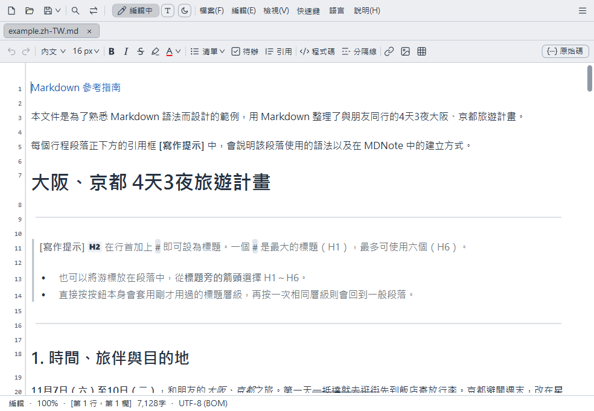

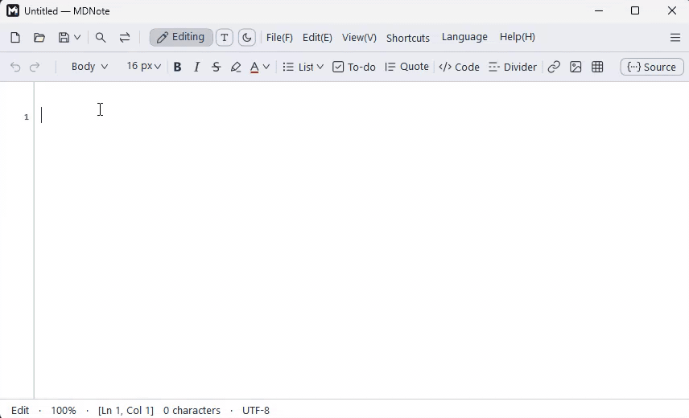

## 下載

[下載最新版本 (Releases)](https://github.com/Lahai-Roi/MDNote/releases/latest)

- `MDNote-Setup-2.3.0.exe`：安裝檔。可在安裝的第一個畫面選擇語言。
- `MDNote-2.3.0-portable.zip`：免安裝可攜版。解壓縮後直接執行 `MDNote.exe`。
- 需要 Windows 10/11 64 位元與 .NET Framework 4.8（Windows 內建）。
- 由於執行檔沒有數位簽章，首次執行時 Windows 可能會跳出警告，請點選 **其他資訊 → 仍要執行**。

## 主要功能

- **所見即所得編輯**：隱藏 `#`、`**` 等符號，依排版效果直接書寫。需要查看符號時，可切換到**即時模式**或**原始碼**。
- **工具列與表格編輯**：用按鈕插入標題、粗體、文字顏色、清單、程式碼、連結、圖片和表格，表格可直接在儲存格中編輯。
- **GitHub 格式與公式**：提示框（GitHub 與 Obsidian 風格）、醒目提示、註腳、`[TOC]`、表情符號和公式（`$E=mc^2$`）都會直接顯示。
- **TXT 模式**：像記事本一樣有行號的純文字編輯。
- **分頁、視窗與大綱**：以分頁或新視窗開啟多份文件，透過標題清單或同一資料夾的檔案清單快速移動。
- **圖片整理**：貼上或拖入的圖片會在儲存時集中到文件旁的資料夾。
- **尋找取代、列印、儲存為 HTML、多種編碼**（UTF-8、CP949、Shift JIS、GBK、Big5 等）
- **繼續上次工作階段、檔案變更提醒**
- **深色、專注與打字機模式，自訂快速鍵，5 種語言**

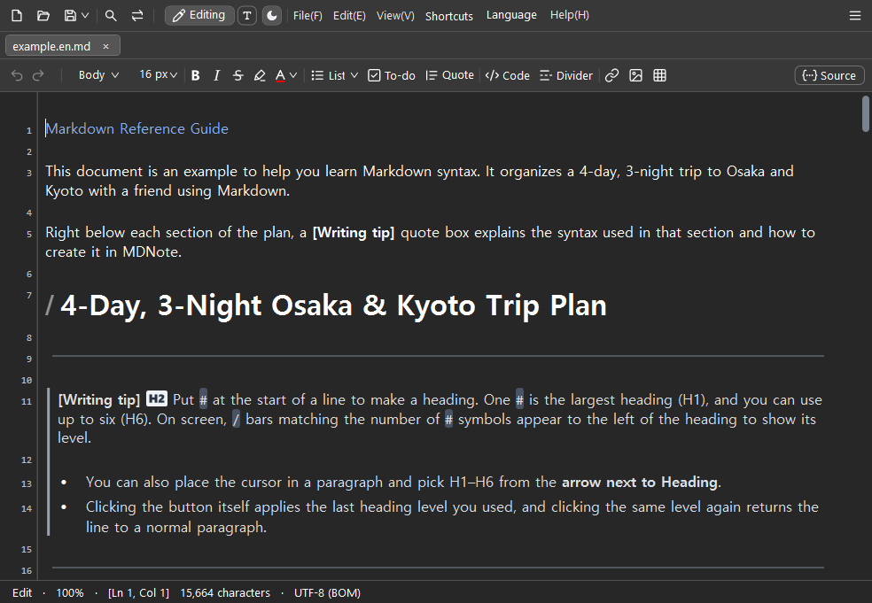

## 畫面功能一覽

| | |
|---|---|
| 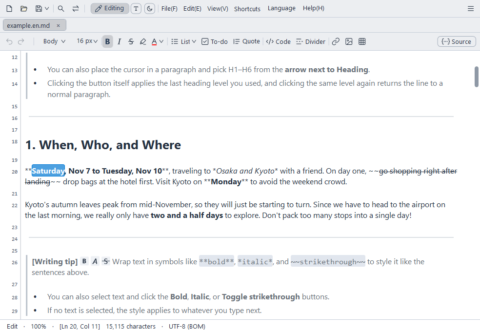<br>**即時模式**：僅游標所在行顯示 Markdown 符號，其餘部分皆依套用格式的版面顯示。 | 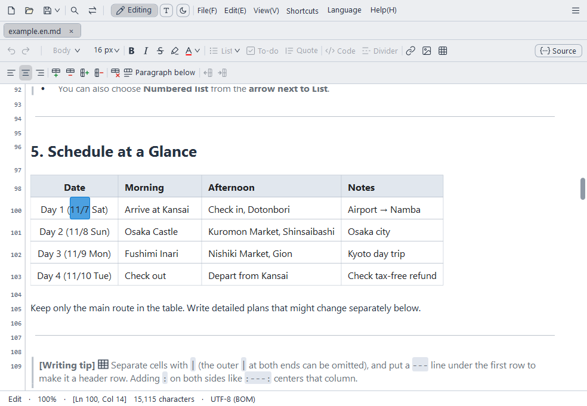<br>**表格編輯**：直接在儲存格內輸入，並使用工具列新增行列與調整對齊。 |
| 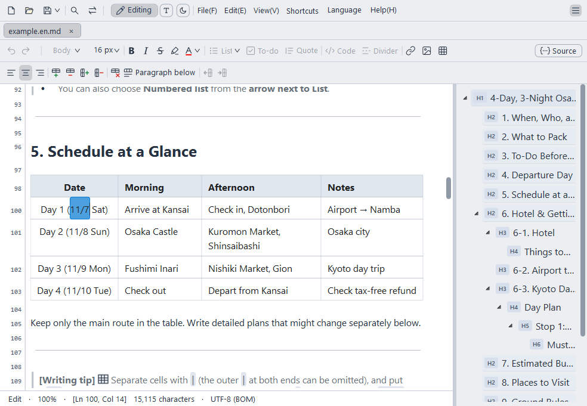<br>**大綱**：點選標題清單即可直接跳轉到該位置。 | 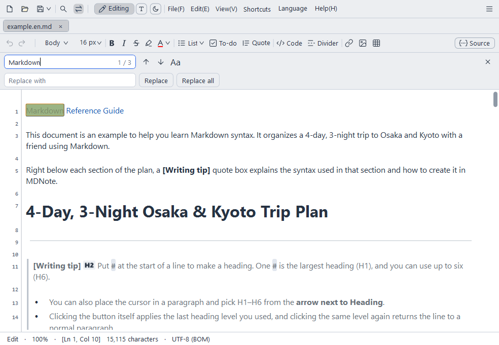<br>**尋找與取代**：尋找文件內的文字並一次全部取代。 |
| 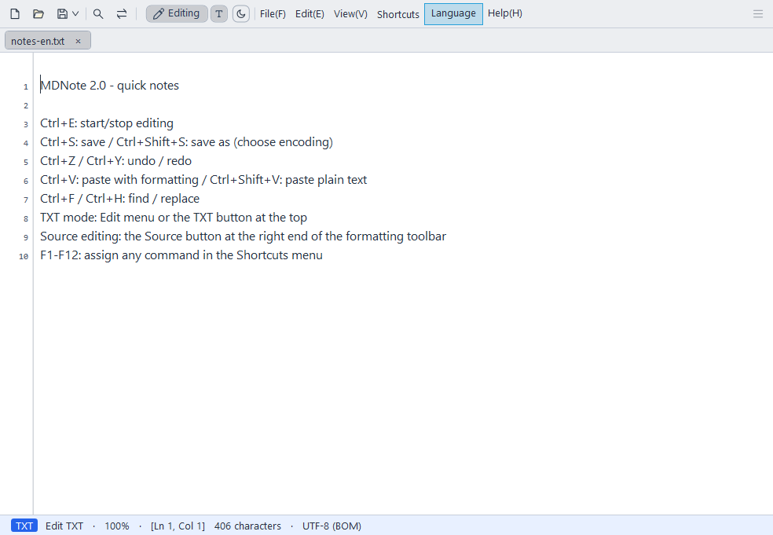<br>**TXT 模式**：像顯示行號的記事本一樣編寫純文字。 | 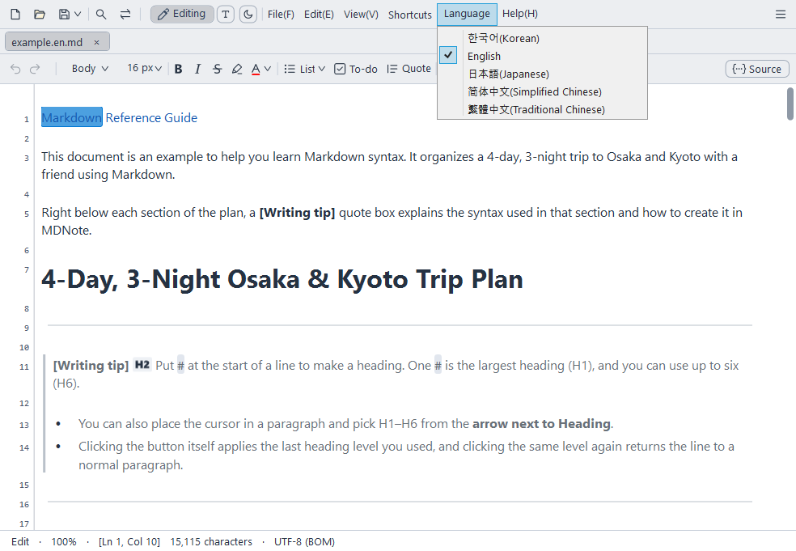<br>**5 種語言**：選單、說明與範例文件皆會切換為所選語言。 |
| 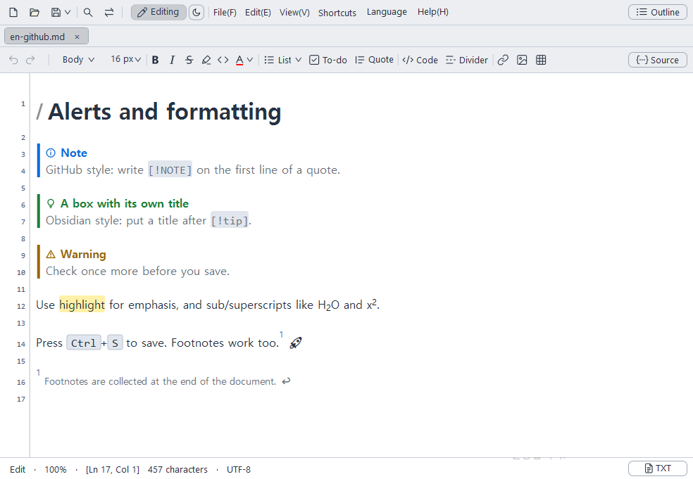<br>**提示框與格式**：GitHub 提示框、可自訂標題的 Obsidian 風格標註框，以及醒目提示、註腳和按鍵樣式。 | 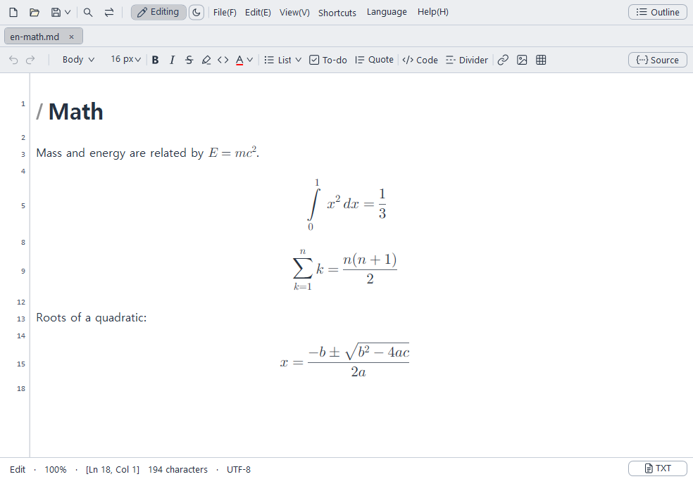<br>**公式**：句中的 `$…$` 和單獨成行的 `$$…$$` 會渲染為公式。 |

## 使用方法

應用程式的**說明**選單裡有兩份文件：

- **MD檔案撰寫方法**：標題、清單、表格、圖片、程式碼的寫法與範例
- **MDNote使用說明**：選單、快速鍵與檢視設定的完整說明

## 限制

- 僅支援 Windows（Windows 10/11 64 位元）。
- 流程圖（Mermaid）等擴充語法不會轉換為圖形，而是直接顯示輸入的文字。
- 若要儲存為 PDF，請在列印選單中選擇「Microsoft Print to PDF」。

## 常見問題

**儲存的檔案可以用其他程式開啟嗎？**
可以。檔案會儲存為標準 Markdown（.md）或純文字（.txt），因此在其他編輯器中也能原樣開啟。不過，像文字顏色這類標準 Markdown 沒有的格式，會以 HTML 標籤儲存。

**我想邊看 Markdown 符號邊寫作。**
開啟 **檢視 → Markdown 即時預覽** 後，只有游標所在的那一行會顯示符號。若要讓整份文件都顯示符號，請點選右上角的**原始碼**按鈕。

**緊接著粗體文字後面繼續打字，還會維持粗體嗎？**
會。緊接著粗體結尾輸入會與粗體按鈕的狀態一致，繼續維持粗體；先輸入空格再打字則為一般文字。

**首次執行時 Windows 跳出了警告。**
這是因為執行檔沒有數位簽章。請點選 **其他資訊 → 仍要執行**。

**可以不安裝直接使用嗎？**
可以。解壓縮 `MDNote-2.3.0-portable.zip` 後執行 `MDNote.exe` 即可。

**要如何解除安裝？**
安裝版請從 Windows 設定的應用程式清單中移除。若安裝資料夾中有您自行放入的檔案，只會留下該檔案。免安裝可攜版只需將解壓縮的資料夾刪除即可。

## 隱私權

- MDNote 預設不連線至網際網路，僅在點選**說明 → 檢查更新**時，或開啟**自動檢查更新**後（預設關閉，每次啟動程式時），從 GitHub 檢查最新版本號碼。不會將使用紀錄或文件內容傳送到任何地方。
- 為了復原未儲存的內容，編輯中的內容副本只會存放在您電腦的使用者資料夾（AppData）中，儲存或關閉後即會刪除。
- 設定（字型、語言、快速鍵等）也只會儲存在您的電腦上。

## 錯誤回報與建議

請至 [Issues](https://github.com/Lahai-Roi/MDNote/issues) 留言。若能一併提供以下資訊，將有助於我們更快修正問題：

- 做了什麼操作時（點選的選單或按鍵、輸入的文字）發生了什麼狀況，以及原本應該如何運作
- Windows 版本、使用的輸入法（韓文、日文、中文等）
- 若方便請附上畫面截圖。請勿上傳包含個人隱私的文件內容。

## 從原始碼建置

使用 Windows 內建的 .NET Framework 4.8 C# 編譯器即可建置，不需要安裝 Visual Studio。

```powershell
.\src\build.ps1
```

會在 `src` 資料夾中產生 `MDNote.exe`。

安裝檔使用 [NSIS 3](https://nsis.sourceforge.io/) 製作，詳細步驟請參考 [src/installer/README.md](src/installer/README.md)。

## 授權條款

MDNote 採用 [GNU General Public License v3.0](LICENSE) 散佈。
包含修改過的 [AvalonEdit](https://github.com/icsharpcode/AvalonEdit)（MIT 授權條款）。詳情請參閱 [THIRD_PARTY_NOTICES.txt](src/THIRD_PARTY_NOTICES.txt)。

Copyright (c) 2026 Lahai-Roi
