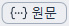

# MDNote 사용법

MDNote의 메뉴와 화면을 위쪽 메뉴 순서대로 설명합니다. 문서에 제목·목록·표를 넣는 방법은 **도움말 → MD파일 작성방법**에서 볼 수 있습니다.

## 1. 파일

| 메뉴 | 단축키 | 설명 |
| --- | --- | --- |
|  새로 만들기 | Ctrl+N, Ctrl+T | 새 문서를 엽니다. |
|  열기… | Ctrl+O | MD·TXT 파일을 엽니다. |
| 인코딩을 지정하여 열기… | | 글자가 깨져 보일 때 인코딩을 골라 다시 엽니다. |
| 복구할 문서… | | 저장하지 않고 닫힌 문서를 복구하거나 지웁니다. |
| 최근 파일 | | 최근에 연 문서를 다시 엽니다. |
|  저장 | Ctrl+S | 지금 문서를 저장합니다. |
| 다른 이름으로 저장… | Ctrl+Shift+S | 새 이름과 인코딩을 골라 저장합니다. |
| 인쇄… | Ctrl+P | 문서를 인쇄합니다. |
| 끝내기 | Alt+F4 | 지금 창만 닫습니다. 다른 창은 그대로 남습니다. |

- 파일을 창에 끌어다 놓거나 탐색기에서 더블클릭해도 열립니다.
- 저장하지 않은 글은 앱을 켤 때 복구할지 물어보며, **복구할 문서…**(선택 복구·선택 삭제·나중에)에서 직접 복구하거나 지울 때까지 보관됩니다.
- **다른 이름으로 저장**의 인코딩은 UTF-8·UTF-8(BOM)·UTF-16 LE·UTF-16 BE·ANSI(CP949) 중에서 고르거나, Shift JIS·GBK·Big5·Windows-1252·UTF-32 LE/BE로 연 문서는 현재 인코딩 유지를 고를 수 있습니다. CP949로 나타낼 수 없는 글자가 있으면 UTF-8로 저장하라고 알려 줍니다.
- MD와 TXT 모드를 바꿔 파일 확장자와 맞지 않게 되면, 저장할 때 바뀐 모드에 맞는 확장자를 제안해 원래 파일을 덮어쓰지 않게 합니다.
- 저장하지 않은 문서를 닫으면 **저장·버리기·취소** 중에서 고릅니다. 윈도우 종료 등으로 여러 창이 한꺼번에 닫힐 때 **취소**를 누르면 나머지 창 닫기를 멈춥니다.

## 2. 편집

| 메뉴 | 단축키 | 설명 |
| --- | --- | --- |
|  수정 시작/종료 | Ctrl+E | 읽기 화면과 수정 화면을 오갑니다. |
| 항상 수정 기능 활성화 | | 켜면 문서를 열자마자 수정할 수 있습니다. |
|  TXT 모드 | | MD 문서를 일반 텍스트로 바꾸거나 되돌립니다. |
| 새 문서는 항상 TXT 모드 활성화 | | 켜면 새 문서가 TXT로 시작합니다. |
| 실행 취소 / 다시 실행 | Ctrl+Z / Ctrl+Y | 방금 한 편집을 취소하거나 다시 적용합니다. 이어서 친 글자(백스페이스 포함)는 한 번에 되돌아가고, 커서 이동·Delete·붙여넣기·잘라내기·명령 실행·포커스 이동·문서 전환 뒤에 친 글자는 새 단계로 나뉩니다. |
| 모두 선택 / 복사 / 잘라내기 | Ctrl+A / Ctrl+C / Ctrl+X | 전체를 선택하거나 선택한 글자를 복사·잘라냅니다. |
| 붙여넣기 | Ctrl+V | 서식을 살려서 붙여 넣습니다. |
| 서식 없이 붙여넣기 | Ctrl+Shift+V | 글자만 붙여 넣습니다. |
| 이미지 삽입… | Ctrl+Shift+I | 그림을 넣습니다. |
|  찾기… | Ctrl+F | 글자를 찾습니다. |
|  바꾸기… | Ctrl+H | 글자를 찾아 바꿉니다. |

- 문서는 **항상 수정 기능 활성화**가 켜져 있으면(처음 값) 바로 수정 화면으로 열리고, 끄면 **읽기** 화면으로 열립니다. 기본 모드의 수정 화면에서는 `#`, `**` 같은 기호가 숨겨진 채 서식이 적용된 모양 그대로 편집합니다. **라이브 모드**(보기 메뉴)에서는 수정 화면에서 커서가 있는 줄과 선택한 줄만 기호가 보입니다.
- **TXT 모드**로 바꾸면 기호는 지워지고 보이는 글자만 남으며, 표는 칸 사이를 Tab으로 나눕니다. TXT를 MD로 바꾸면 이미 적힌 기호가 갑자기 서식으로 바뀌지는 않습니다. 실수로 바꿨다면 Ctrl+Z로 되돌립니다.
- **붙여넣기**는 굵게·기울임·취소선·링크와 따로 지정한 글자 색을 살립니다. TXT 모드에서는 늘 글자만 붙여 넣습니다.
- 그림 파일을 편집 창에 끌어다 놓아도 그림이 들어갑니다.
- 찾기·바꾸기는 같은 단축키를 한 번 더 누르면 닫힙니다.

## 3. 보기

| 메뉴 | 단축키 | 설명 |
| --- | --- | --- |
| 새 탭으로 보기 | | 켜면 파일이 새 탭으로, 끄면 새 창으로 열립니다. |
| 자동 줄바꿈 | | 창 너비에 맞춰 줄을 넘겨 보여 줍니다. |
| 글자 확대 / 글자 축소 | Ctrl++ / Ctrl+- | Ctrl+휠로도 됩니다. |
| 기본 글자 크기 | Ctrl+0 | 원래 크기로 돌아옵니다. |
| 글꼴 및 크기… | | 기본 글꼴과 크기를 정합니다. |
| 기본 글자색… / 기본 글자색 초기화 | | 문서 전체의 기본 색을 정하거나 되돌립니다. |
|  다크 모드 | | 어두운 색 화면으로 바꿉니다. |
| 줄 간격 | | 100·125·150·200%와 사용자 지정 중에서 고릅니다. |
| Markdown 라이브 미리보기 | | 켜면 수정 화면에서 커서가 있는 줄과 선택한 줄만 원문(기호 포함)으로 보여 줍니다. 끄면 기본 모드입니다. |

- **새 탭으로 보기**를 끄는 순간 열려 있던 탭들은 각각 새 창으로 나뉩니다.
- **자동 줄바꿈**은 파일에 줄바꿈을 넣지 않습니다. 끄면 긴 줄을 가로 스크롤로 봅니다.
- 서식 도구 줄의 글자색은 선택한 글자에만 적용되는 서식이라 **기본 글자색**과 따로 동작합니다.
- **줄 간격**의 처음 기본값은 150%이고 MD와 TXT 모두에 적용됩니다.
- **기본 모드**는 문서 전체가 서식이 적용된 모양으로 보이고, 커서가 있는 줄도 `**`·`#` 같은 기호를 숨깁니다. 처음 실행하면 이 모드입니다.
- **라이브 보기**는 보기 → **Markdown 라이브 미리보기**를 켜면 수정 화면에서 커서가 있는 줄과 선택한 줄만 원문(기호 포함)으로 보여 줍니다(읽기 화면에서는 늘 서식이 적용된 모양만 보입니다). 기호를 직접 보며 고칠 때 편합니다. 처음에는 꺼져(기본 모드) 있고, 바꾼 모드는 다음에 실행할 때도 기억됩니다.
- 보기 설정은 화면 표시만 바꿀 뿐 파일 내용에는 영향을 주지 않습니다.

## 4. 단축키

| 키 | 기본 기능 | 키 | 기본 기능 |
| --- | --- | --- | --- |
| F1 | 수정 모드 | F7 | 인라인 코드 |
| F2 | 원문 편집 | F8 | 코드 블록 |
| F3 | 마지막 선택 제목 | F9 | 표 삽입 |
| F4 | 마지막 선택 목록 | F10 | 아웃라인 |
| F5 | 체크리스트 삽입/해제 | F11 | 이전 탭 |
| F6 | 인용 | F12 | 다음 탭 |

- **단축키** 메뉴에서 F1~F12에 원하는 기능을 지정하고, 기본값으로 되돌릴 수도 있습니다. 찾기·바꾸기 입력칸이나 글자 크기 상자 같은 입력칸에 커서가 있을 때는 F1~F12 단축키가 동작하지 않습니다.

## 5. 언어

| 메뉴 | 설명 |
| --- | --- |
| 한국어(Korean) · English · 日本語(Japanese) · 简体中文 · 繁體中文 | 메뉴와 화면 문구의 언어를 바꿉니다. |

- 도움말 문서도 고른 언어로 열립니다.

## 6. 도움말

| 메뉴 | 설명 |
| --- | --- |
| MD파일 작성방법 | Markdown 문법과 작성 팁을 담은 예제 문서를 엽니다. |
| MDNote 사용법 | 이 문서를 엽니다. |
| MDNote 정보 | 버전을 확인합니다. |

## 7. 도구 줄과 화면

| 도구 | 위치 | 설명 |
| --- | --- | --- |
| 서식 도구 줄 | 메뉴 아래 (수정 중) | 제목·글자 꾸미기·목록·체크·인용·코드·링크·이미지·표 버튼이 있습니다. |
|  원문 | 서식 도구 줄 오른쪽 끝 | 기호와 HTML 태그가 그대로 보이는 원문을 편집합니다. |
|  TXT | 위쪽 | 편집 → **TXT 모드**와 같습니다. |
|  아웃라인 | 오른쪽 위 | 제목 목록을 보여 주고, 누르면 그 제목으로 이동합니다. |
| 표 도구 줄 | 표 안에 커서를 놓았을 때 | 왼쪽·가운데·오른쪽 정렬, 행·열 추가와 제거, 표 삭제, 아래 문단 추가, 들여쓰기·내어쓰기 버튼이 있습니다. 열 정렬은 둘째 줄(`---`)을 직접 고치지 않고 이 정렬 버튼으로 바꿉니다. |

- **원문**을 끄면 서식이 적용된 화면으로 돌아옵니다.
- TXT 모드에서는 줄 번호가 보이는 일반 텍스트 편집을 합니다.
- 아웃라인은 H1~H6 표시와 함께 나오며, 본문과의 경계선을 끌어 너비를 바꿉니다.

## 8. 입력할 때의 동작

| 위치 | 키 | 동작 |
| --- | --- | --- |
| 줄 맨 앞 | `-`, `*`, `+`, `1.` 다음 반각 공백 한 칸이나 Tab | 바로 목록이 됩니다. (전각 공백은 일반 글자로 취급되어 목록이 되지 않습니다.) |
| 목록 | Tab / Shift+Tab | 한 단계 들여쓰거나 내어씁니다. |
| 빈 목록 항목 | Enter | 같은 단계에 빈 항목이 하나 더 생깁니다. |
| 목록 항목 맨 앞 | Backspace | 한 번은 목록 표시, 두 번은 들여쓰기까지 지웁니다. |
| 글이 있는 체크박스 줄 | Enter | 새 체크박스 줄이 생깁니다. |
| 굵게·기울임·취소선·인라인 코드 안 | Enter | 기본 모드와 라이브 모드 모두 줄을 바꿔도 두 줄 다 서식이 그대로 이어집니다. |
| 표 칸 안 | Home / End | 그 칸의 처음 / 끝으로 갑니다. |
| 표 칸 안 | ↑ / ↓ | 칸 안에서 줄을 옮기고, 칸의 마지막 줄에서는 아래 행의 같은 칸으로 넘어갑니다. |
| 표 안 | Tab / Shift+Tab | 다음 칸이나 이전 칸으로 이동하며 그 칸의 글자를 선택합니다. 마지막 행의 마지막 칸에서 Tab을 누르면 아래에 새 행이 추가됩니다. 글자나 칸을 선택한 채 누르면 글자를 지우지 않고 선택 끝 다음 칸(Shift+Tab은 선택 앞 칸)으로 이동만 합니다. |
| 표 바로 앞이나 뒤 | Enter | 표 밖에 빈 줄이 생깁니다. |
| 표 안 | Ctrl+] / Ctrl+[ | 표 전체를 바로 위 목록 항목 안에 넣거나 밖으로 뺍니다. |

- 체크리스트를 그만 쓰려면 새로 생긴 빈 체크박스 줄에서 **Backspace**로 상자를 지웁니다.
- 읽기·수정 화면 모두 상자를 눌러 완료 표시를 바꿀 수 있습니다. 바꾼 뒤 **Ctrl+S**로 저장해야 파일에 남습니다.
- 표에서 일부 칸을 선택하고 지우거나 글자를 치면 구분선(`|`)과 표 모양은 그대로 남고 선택한 칸의 내용만 지워지거나 바뀝니다. 다만 표 전체를 선택하거나 Ctrl+A로 모두 선택해 지우면 일반 글자처럼 표 자체가 지워집니다.

표의 둘째 줄(`---` 구분선 줄)은 수정 화면에서 직접 고칠 수 없습니다. 열 정렬은 표 도구 줄의 정렬 버튼(또는 원문 화면)에서 바꿉니다.

표 양 끝의 바깥쪽 `|`는 생략해도 같은 표로 인식합니다. 칸 안에서 `|`를 치면 표가 깨지지 않도록 자동으로 `\|`로 저장되며, `코드` 안에 친 `|`는 그대로 남고 칸이 나뉘지 않습니다.

- 바로 위가 목록이 아니면 표 도구 줄의 들여쓰기 버튼이 흐려집니다.

## 9. 탭과 창

| 단축키 | 동작 |
| --- | --- |
| Ctrl+W | 탭 닫기 |
| Ctrl+Tab / Ctrl+Shift+Tab | 다음 탭 / 이전 탭 |

- 비어 있는 창이 있으면 새로 열지 않고 그 창에서 엽니다.
- 창 위치·크기와 보기·편집·언어 설정은 앱을 다시 켜거나 업데이트해도 그대로 유지됩니다.

## 10. 알려진 제한

- 기본 모드의 수정 화면에서는 **Alt+드래그** 사각 선택을 쓸 수 없습니다. 라이브 모드나  **원문** 화면에서는 쓸 수 있습니다.
