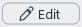
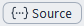

# Using MDNote

This guide explains MDNote's menus and screen in the order of the top menu bar. To learn how to add headings, lists, and tables, see **Help → Writing Markdown**.

## 1. File

| Menu | Shortcut | Description |
| --- | --- | --- |
| Continue previous session | | When on, closes unsaved documents without prompting and reopens them as they were the next time you open MDNote. Off by default. |
|  New | Ctrl+N, Ctrl+T | Open a new document. |
|  Open… | Ctrl+O | Open an MD or TXT file. |
| Open with encoding… | | Reopen a file with a chosen encoding if text looks garbled. |
| Recover documents… | | Recover or delete documents that were closed without saving. |
| Recent files | | Reopen a recently opened document. |
|  Save | Ctrl+S | Save the current document. |
| Save as… | Ctrl+Shift+S | Save with a new name and encoding. |
| Print… | Ctrl+P | Print the document. |
| Exit | Alt+F4 | Close the current window only. Other open windows remain open. |

- You can also open files by dragging them into the window or double-clicking them in File Explorer.
- Unsaved text is kept until you recover or delete it—MDNote asks whether to recover it on launch, or you can manage it anytime in **Recover documents…** (Recover selected, Delete selected, or Later).
- In **Save as**, choose an encoding from UTF-8, UTF-8 (BOM), UTF-16 LE, UTF-16 BE, or ANSI (CP949), or keep the current encoding for documents opened in Shift JIS, GBK, Big5, Windows-1252, or UTF-32 LE/BE. If any characters cannot be represented in CP949, MDNote prompts you to use UTF-8.
- If switching between MD and TXT mode makes the mode differ from the file extension, saving suggests the matching extension so you do not overwrite the original file.
- When closing an unsaved document, choose **Save**, **Discard**, or **Cancel**. When multiple windows are closing at once (such as during Windows shutdown), clicking **Cancel** stops closing the remaining windows.

## 2. Edit

| Menu | Shortcut | Description |
| --- | --- | --- |
|  Toggle editing | Ctrl+E | Switch between the read view and editing view. |
| Always open for editing | | When on, documents open ready for editing right away. |
|  TXT mode | | Convert an MD document to plain text or back. |
| Start new documents in TXT mode | | When on, new documents start in TXT mode. |
| Undo / Redo | Ctrl+Z / Ctrl+Y | Undo or redo your last edit. Consecutive typing (including Backspace) is undone in one step, while typing after moving the cursor, pressing Delete, pasting, cutting, running a command, changing focus, or switching documents starts a new undo step. |
| Select all / Copy / Cut | Ctrl+A / Ctrl+C / Ctrl+X | Select everything, or copy or cut the selected text. |
| Paste | Ctrl+V | Paste while keeping formatting. |
| Paste without formatting | Ctrl+Shift+V | Paste plain text only. |
| Insert image… | Ctrl+Shift+I | Insert an image. |
|  Find… | Ctrl+F | Find text. |
|  Replace… | Ctrl+H | Find and replace text. |

- Documents open straight into the editing screen while **Always open for editing** is on (the default), or in the **Read** screen when it is off. In basic mode's editing screen, symbols like `#` and `**` stay hidden while you edit directly in the formatted view. In **Live mode** (View menu), symbols appear in the editing screen only on the cursor line and any selected lines.
- Switching to **TXT mode** strips Markdown symbols and leaves only visible text, separating table cells with Tabs. Switching from TXT back to MD does not suddenly turn existing symbols into formatting. If you switched by mistake, press Ctrl+Z to undo.
- **Paste** preserves bold, italic, strikethrough, links, and custom text colors. In TXT mode, pasting always inserts plain text only.
- **Insert images**: Paste a copied image with Ctrl+V, paste or drag in an image file, or select Insert image… to display it immediately. When saving, a folder with the same name is created next to the document (e.g., `Memo.md` → `Memo\`), storing only the images remaining in the document and updating their links. Images deleted before saving are excluded, and images already in that folder are not copied again. Using Save As copies the document's images into a folder matching the new name.
- You can also drag an image file into the editing window to insert it.
- Press the same shortcut again to close Find or Replace.

## 3. View

| Menu | Shortcut | Description |
| --- | --- | --- |
| Open files in tabs | | When on, files open in new tabs; when off, they open in new windows. |
| Word wrap | | Wrap lines to fit the window width. |
| Increase text size / Decrease text size | Ctrl++ / Ctrl+- | Also works with Ctrl+mouse wheel. |
| Reset text size | Ctrl+0 | Return to the default text size. |
| Font and size… | | Set the default font and size. |
| Default text color… / Reset default text color | | Set or reset the default text color for the whole document. |
|  Dark mode | | Switch to a dark color theme. |
| Line spacing | | Choose 100%, 125%, 150%, 200%, or Custom. |
| Markdown Live Preview | | When on, shows only the cursor line and selected lines as source text (with symbols) in the editing screen. When off, uses the basic mode. |

- The moment you turn off **Open files in tabs**, any open tabs split into separate windows.
- **Word wrap** does not insert actual line breaks into the file. When off, long lines scroll horizontally.
- Text color on the formatting toolbar applies only to selected text and works separately from **Default text color**.
- **Line spacing** defaults to 150% and applies to both MD and TXT.
- **Basic mode** shows the entire document formatted and hides symbols like `**` and `#` even on the cursor line. MDNote starts in this mode on first launch.
- **Live view** (View → **Markdown Live Preview**) shows only the cursor line and selected lines as source text (with symbols) in the editing screen (the Read screen always shows the formatted view). This is handy when editing Markdown syntax directly. It is off (basic mode) by default, and any change you make is remembered next time you launch the app.
- View settings only change how the screen looks and do not affect the file contents.

## 4. Shortcuts

| Key | Default action | Key | Default action |
| --- | --- | --- | --- |
| F1 | Editing mode | F7 | Inline code |
| F2 | Source editing | F8 | Code block |
| F3 | Last heading level | F9 | Insert table |
| F4 | Last list style | F10 | Outline |
| F5 | Toggle task list | F11 | Previous tab |
| F6 | Quote | F12 | Next tab |

- In the **Shortcuts** menu, you can assign any action to F1–F12 or restore defaults. F1–F12 shortcuts do not run while the cursor is inside an input box such as Find/Replace or the font size box.

## 5. Language

| Menu | Description |
| --- | --- |
| 한국어(Korean) · English · 日本語(Japanese) · 简体中文 · 繁體中文 | Change the language of menus and screen labels. |

- Help documents also open in the selected language.

## 6. Help

| Menu | Description |
| --- | --- |
| Writing Markdown | Open an example document with Markdown syntax and writing tips. |
| Using MDNote | Open this guide. |
| About MDNote | Check the app version. |

## 7. Toolbars and Screen

| Tool | Location | Description |
| --- | --- | --- |
| Formatting toolbar | Below the menu bar (while editing) | Buttons for Heading, text styling, List, To-do, Quote, Code, Link, Image, and Table. |
|  Source | Far right of the formatting toolbar | Edit the raw source with Markdown symbols and HTML tags visible. |
|  TXT | Top bar | Same as Edit → **TXT mode**. |
|  Outline | Top right | Shows the heading list; click a heading to jump to it. |
| Table toolbar | When the cursor is inside a table | Buttons for Align left, center, and right, Add/Remove row, Add/Remove column, Delete table, Add paragraph below, and indent/outdent. Change column alignment with these alignment buttons rather than editing the second row (`---`) directly. |

- Turning off **Source** returns to the formatted view.
- In TXT mode, you edit plain text with line numbers shown.
- The Outline displays H1–H6 markers, and you can drag its border with the document to resize it.

## 8. Typing Behavior

| Location | Key | Behavior |
| --- | --- | --- |
| Start of a line | `-`, `*`, `+`, or `1.` followed by a half-width space or Tab | Immediately starts a list. (A full-width space is treated as normal text and does not start a list.) |
| Inside a list | Tab / Shift+Tab | Indent or outdent by one level. |
| Empty list item | Enter | Creates another empty item at the same level. |
| Start of a list item | Backspace | First press removes the list marker; second press removes the indent. |
| Non-empty checkbox line | Enter | Creates a new checkbox line below. |
| Inside bold, italic, strikethrough, or inline code | Enter | In both basic mode and Live mode, pressing Enter continues the formatting across both lines. |
| Inside a table cell | Home / End | Move to the start or end of that cell. |
| Inside a table cell | ↑ / ↓ | Move between lines inside the cell, or from the last line to the same column in the row below. |
| Inside a table | Tab / Shift+Tab | Move to the next or previous cell and select its text. Pressing Tab in the last cell of the last row adds a new row below. If text or cells are selected, pressing Tab or Shift+Tab moves to the cell after (or before) the selection without deleting the text. |
| Right before or after a table | Enter | Inserts a blank line outside the table. |
| Inside a table | Ctrl+] / Ctrl+[ | Indent the entire table into the list item above, or outdent it back out. |

- To stop a task list, press **Backspace** on the newly created empty checkbox line to remove the box.
- You can click checkboxes to toggle completion in both Read and editing views. Press **Ctrl+S** afterward to save the change to the file.
- Selecting some cells in a table and deleting or typing keeps the pipe dividers (`|`) and table structure intact, clearing or replacing only the contents of the selected cells. However, selecting the entire table or pressing Ctrl+A and deleting removes the table itself like normal text.

The second row of a table (the `---` delimiter row) cannot be edited directly in the editing screen. Use the alignment buttons on the table toolbar (or the Source view) to change column alignment.

Outer `|` characters at the left and right edges of a table are optional. Typing `|` inside a cell automatically saves it as `\|` so the table does not break, while `|` typed inside `code` stays as-is without splitting the cell.

- If there is no list directly above the table, the indent button on the table toolbar is dimmed.

## 9. Tabs and Windows

| Shortcut | Behavior |
| --- | --- |
| Ctrl+W | Close tab |
| Ctrl+Tab / Ctrl+Shift+Tab | Next tab / Previous tab |

- If an empty untitled window is already open, opening a file reuses that window instead of opening a new one.
- Window position and size, along with View, Edit, and Language settings, are preserved when you restart or update the app.

## 10. Known Limitations

- **Alt+drag** rectangular (column) selection is not available in basic mode's editing screen. It is available in Live mode and in the  **Source** view.