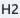
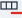
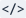
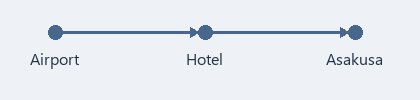

[Markdown Reference Guide](https://commonmark.org/help/)

This document is an example to help you learn Markdown syntax. It organizes a 4-day, 3-night trip to Osaka and Kyoto with a friend using Markdown.

Right below each section of the plan, a **[Writing tip]** quote box explains the syntax used in that section and how to create it in MDNote.

# 4-Day, 3-Night Osaka & Kyoto Trip Plan

---

> **[Writing tip]**  Put `#` at the start of a line to make a heading. One `#` is the largest heading (H1), and you can use up to six (H6). On screen, `/` bars matching the number of `#` symbols appear to the left of the heading to show its level.
>
> - You can also place the cursor in a paragraph and pick H1–H6 from the **arrow next to Heading**.
> - Clicking the button itself applies the last heading level you used, and clicking the same level again returns the line to a normal paragraph.

---

## 1. When, Who, and Where

**Saturday, Nov 7 to Tuesday, Nov 10**, traveling to *Osaka and Kyoto* with a friend. On day one, ~~go shopping right after landing~~ drop bags at the hotel first. Visit Kyoto on **Monday** to avoid the weekend crowd.

Kyoto's autumn leaves peak from mid-November, so they will just be starting to turn. Since we have to head to the airport on the last morning, we really only have **two and a half days** to explore. Don't pack too many stops into a single day!

---

> **[Writing tip]**    Wrap text in symbols like `**bold**`, `*italic*`, and `~~strikethrough~~` to style it like the sentences above.
>
> - You can also select text and click the **Bold**, **Italic**, or **Toggle strikethrough** buttons.
> - If no text is selected, the style applies to whatever you type next.

Pressing Enter inside bold, italic, strikethrough, or inline code keeps the formatting on both lines after the line break.

---

## 2. What to Pack

Pack the **things you can't travel without** first, like your passport and phone.

- Passport (check that it's valid through the return date)
- Phone
  - eSIM (activate before departure)
  - Power bank (carry-on only, not allowed in checked luggage)
  - Plug adapter (Japan uses Type A two-flat-pin outlets, 100V)
- Payment methods
  - 2 cards enabled for international payment
  - 20,000–30,000 yen in cash
  - Coin pouch (100- and 500-yen coins pile up fast)
- Comfortable walking shoes
- Folding umbrella and a light jacket (Kyoto mornings in November drop into single-digit °C)

---

> **[Writing tip]**  Type `-` followed by a half-width space (or Tab) at the start of a line to make a bulleted list (a full-width space does not start a list). Add two spaces in front to indent an item one level deeper.
>
> - Use the **arrow next to List** to choose between a bulleted list and a numbered list. Clicking the button itself applies the last list style used, and its icon shows which list style is active.
> - Press **Tab** to indent one level, or **Shift+Tab** to outdent one level.
> - Pressing **Enter** on an empty item adds another empty item at the same level. Pressing **Backspace** once removes the list marker, and pressing it twice removes the indent too.

---

## 3. To-Do Before Departure

- [x] Book flights (Incheon ↔ Kansai)
- [x] Book Namba hotel
- [ ] Register on Visit Japan Web and screenshot the immigration/customs QR code
- [ ] Buy travel insurance
- [ ] Buy and activate eSIM
- [ ] Add ICOCA (transit card) to phone wallet
- [ ] Exchange yen cash

---

> **[Writing tip]**  `- [ ] ` creates an unchecked box, and `- [x] ` creates a checked box.
>
> - You can also click the **To-do** button to create one.
> - Click a checkbox in either the Read screen or the editing screen to toggle completion. Press **Ctrl+S** to save the change to the file.

---

## 4. Departure Day

1. Arrive at Incheon Airport at least 2.5 hours before departure
2. Check bags and go through security and departure control
3. Clear immigration at Kansai Airport (pass immigration and customs with a single Visit Japan Web QR code)
4. Take the Nankai Rapi:t to Namba (about 35 min) and drop bags at the hotel
5. Stroll around Dotonbori and grab dinner

---

> **[Writing tip]**  Type a number and a period like `1.` followed by a space at the start of a line to make a numbered list.
>
> - You can also choose **Numbered list** from the **arrow next to List**.

---

## 5. Schedule at a Glance

| Date | Morning | Afternoon | Notes |
| :---: | --- | --- | --- |
| Day 1 (11/7 Sat) | Arrive at Kansai | Check in, Dotonbori | Airport → Namba |
| Day 2 (11/8 Sun) | Osaka Castle | Kuromon Market, Shinsaibashi | Osaka city |
| Day 3 (11/9 Mon) | Fushimi Inari | Nishiki Market, Gion | Kyoto day trip |
| Day 4 (11/10 Tue) | Check out | Depart from Kansai | Check tax-free refund |

Keep only the main route in the table. Write detailed plans that might change separately below.

---

> **[Writing tip]**  Separate cells with `|` (the outer `|` at both ends can be omitted), and put a `---` line under the first row to make it a header row. Adding `:` on both sides like `:---:` centers that column.
>
> - You can also click **Table** and pick the number of columns and rows. The table above has 4 columns and 5 rows.
> - Place the cursor inside a table to show the table toolbar: left, center, and right alignment,  **Add row**,  **Remove row**,  **Add column**,  **Remove column**,  **Delete table**, Add paragraph below, and indent/outdent.
>
> Because the second row (`---`) of a table cannot be edited directly in the editing screen, use the alignment buttons on the table toolbar (or the Source view) to change column alignment. Typing `|` inside a cell automatically inserts `\|`, while `|` inside `code` is kept as-is.
>
> Inside a table, press Tab/Shift+Tab to move to the next/previous cell and select its text; pressing Tab in the last cell adds a new row. If cells or text are selected, pressing Tab moves without deleting the text.
>
> Selecting and deleting some cells clears only their contents while keeping the table, whereas selecting and deleting the entire table (or using Ctrl+A) deletes the table itself.

---

## 6. Hotel & Getting Around

Picked a business hotel near Namba Station—one train ride from the airport and easy access to Kyoto.

### 6-1. Hotel

- 5-minute walk from Namba Station
- 3 nights, no breakfast
- Twin room for 2 guests

#### Things to Check at Check-In

- Check-in at 15:00, check-out at 10:00 (varies between 10:00 and 11:00 by hotel, so double-check the booking confirmation)
- If arriving early, leave bags at the front desk first
- Osaka accommodation tax: 200 yen per person per night, paid separately at check-out

### 6-2. Airport to Hotel

- Nankai Rapi:t: about 35 min, 1,670 yen (all reserved seats)
- Nankai Airport Express: about 45 min, 970 yen (good if traveling light)

Fares are <span style="color:#B91C1C">estimated prices</span> looked up in October 2026, so check again at the station on the day.

---

> **[Writing tip]**  Text color is written like `<span style="color:#B91C1C">text</span>`. Replace `#B91C1C` with any color value you want.
>
> - Select text and pick a color from **Text color** to insert this tag automatically.
> - Set the default text color for the entire document separately from the View menu.

---

### 6-3. Kyoto Day Trip (11/9 Mon)

Lots of walking all day, so comfortable shoes are a must. Fushimi Inari gets crowded from 10:00, so head out early.

#### Day Plan

1. Leave hotel at 7:00, Midosuji Line to Umeda → JR Special Rapid to Kyoto Station (about 1 hr)
2. JR Nara Line to Inari Station, arrive at Fushimi Inari before 8:00
   - Going all the way to the summit takes 2–3 hours round trip, so only go up to Yotsutsuji intersection
   - Lunch at Nishiki Market
3. Afternoon walk around Gion
4. Return to Osaka in the evening (Hankyu Kyoto-Kawaramachi → Umeda)

##### Stop 1: Fushimi Inari

- Fewer people before 8:00, great for photos
- Climbing up to Yotsutsuji and back down takes about 1 to 1.5 hours

###### Must-Know! Market & Alley Etiquette

- No eating while walking in Nishiki Market—eat in front of the stall before moving on
- Photography is prohibited in private alleys south of Gion (the main Hanamikoji street is fine)

---

> **[Writing tip]**  Step down through heading levels from `###` (H3) to `######` (H6) to break a big schedule into smaller sections. When nesting a bulleted list inside a numbered list, indent with three spaces.

---

## 7. Estimated Budget

Generous **per-person estimate**. Update with actual amounts each time we pay, since costs depend on the exchange rate and booking time.

| Item | Per Person | Total for 2 | Notes |
| --- | ---: | ---: | :--- |
| Flights (round trip) | ~300,000 KRW | ~600,000 KRW | LCC, departure tax included |
| Hotel (3 nights) | ~225,000 KRW | ~450,000 KRW | ~150,000 KRW/night for a 2-person room |
| Food (4 days) | ~200,000 KRW | ~400,000 KRW | About 6,000 yen/day |
| Transit | ~50,000 KRW | ~100,000 KRW | Includes airport & Kyoto round trips |
| Admissions & activities | ~30,000 KRW | ~60,000 KRW | Osaka Castle 1,200 yen, river cruise 2,000 yen |
| Souvenirs & buffer | ~100,000 KRW | ~200,000 KRW | With extra cushion |
| **Total** | **~905,000 KRW** | **~1,810,000 KRW** | |

---

> **[Writing tip]** In the raw source, column alignment is indicated by adding `:` to the second row (`---:` aligns right, `:---` aligns left, and `:---:` centers). Because the second row cannot be edited directly in the editing screen, use the left, center, and right alignment buttons on the table toolbar (or the Source view) to change alignment. You can also use styling like `**bold**` inside table cells.

---

## 8. Places to Visit

Spots to drop by one by one if we have spare time.

- Osaka
  | Place | Est. Time | Time of Day |
  | --- | ---: | --- |
  | Osaka Castle Main Keep | ~1 hr 30 min | Morning (opens at 9:00) |
  | Kuromon Market | ~1 hr | Before lunch |
  | Dotonbori River Cruise | ~20 min | Evening |
- Kyoto
  - Fushimi Inari (early morning)
  - Street food at Nishiki Market
  - Matcha dessert in Gion
- Souvenirs to Buy
  - Snacks to share with family and friends
  - Everyday pharmacy essentials

Kuromon Market prices can be steep for tourists, so always check the price tag before buying. Double-check restaurant hours and closing days on a map app before heading over!

---

> **[Writing tip]** Add two spaces before every line of a table to nest it inside the list item right above it.
>
> - You can also click the **Indent** button on the table toolbar to move the table into the list item above.

---

## 9. Ground Rules with My Friend

> Instead of cramming the schedule, take a café break at least once a day.
>
> If it rains, switch to indoor spots and don't overdo it.

> [!WARNING] Passport
> Make sure it's valid for at least 6 months before departure!

---

> **[Writing tip]**  Put `> ` at the start of a line to make a quote. To split paragraphs inside a quote, insert a line with just `>`.
>
> - You can also select paragraphs and click **Quote**. If you select normal paragraphs and quotes together, clicking applies quoting to all of them, and clicking again removes it.
> - Put `[!NOTE]`, `[!TIP]`, `[!IMPORTANT]`, `[!WARNING]`, or `[!CAUTION]` on the first line of a quote to turn it into a callout box with a colored bar and icon, like "Passport" above. Any text after the marker becomes the title; if left blank, the type name (such as "Warning") is used as the title. This syntax is also used in GitHub and Obsidian.

---

## 10. Booking Reference & Useful Links

[Visit Japan Web](https://www.vjw.digital.go.jp/)

[Japan National Tourism Organization](https://www.japan.travel/)

[Kyoto City Official Travel Guide](https://kyoto.travel/en/)

Hotel booking number: `OSAKA-EXAMPLE-2026`. Tag confirmed items with `Booked` and things to check later with `Needs check`.

---

> **[Writing tip]**  Write links as `[display text](URL)`. You can also select text and click **Link** to enter an address.
>
> - While editing, hold **Ctrl** and click a link to open it. In Read mode, just click it directly.
>
>  Wrap text in backticks (`` ` ``) to style it as **inline code** like `Needs check`, which stands out while keeping the body font.

---

## 11. Exchange Rate & Tax-Free Notes

Quick mental math for converting yen to won while shopping, based on **100 JPY ≈ 850 KRW** (early October 2026).

```text
KRW = JPY × 8.5
e.g.) 1,000 JPY × 8.5 = ~8,500 KRW
e.g.) 5,000 JPY × 8.5 = ~42,500 KRW
```

Starting in November 2026, tax-free shopping charges the tax-included price upfront and refunds the tax after customs confirmation at departure. Keep receipts and purchased items unpacked until leaving the country.

---

> **[Writing tip]**  Put a ```` ``` ```` line above and below your text to make a code block. You can add a language name after the opening fence, like `text` above.
>
> - You can also select paragraphs and click **Code**. Clicking it again inside a code block turns it back into a normal paragraph without losing the text.
> - Text formatting like bold does not apply inside code blocks.

---

## 12. Route Map

A quick route diagram to review with my friend.



---

> **[Writing tip]**  Insert an image with ``—just like a link, with `!` in front.
>
> - You can also click the **Image** button, press **Ctrl+Shift+I**, or drag an image file into the editing window.
> - Keep image files in the same folder as your MD file (or a subfolder) and write a relative path from the MD file, such as the filename or `images/map.png`.
> - That way, if you move the document to another PC, the images will still show up as long as you move the MD file and image folder together. Full drive paths like `C:\Users\...` won't find the image on another PC.

---

## 13. Post-Trip To-Do

After getting back, settle up using card statements and receipts, and jot down favorite spots right in this file.

- [ ] Settle expenses and compare with the budget table
- [ ] Mark places worth visiting again
- [ ] Pick dates for the next trip

---

> **[Writing tip]** In basic mode of the editing screen, symbols like `**` and `#` stay hidden across the whole screen so you see only the formatted result. Turn on View → Live mode to show the raw source with symbols only on the cursor line (and selected lines) for easy editing (it starts off by default, and your choice is remembered next time). Click the  **Source** button at the far right of the formatting toolbar to view all symbols across the entire document.
>
> - **Ctrl+S** saves, **Ctrl+Z** undoes, and **Ctrl+Y** redoes. Consecutive typing is undone in one step, while moving the cursor or pressing Delete, pasting, or running a command starts a new step.
> - For full instructions on using the app, see **Help → Using MDNote**.