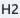
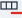
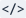
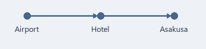

[Markdownリファレンス](https://commonmark.org/help/)

この文書はMarkdownの文法を身につけるためのサンプルです。友人と行く大阪・京都3泊4日の旅行計画をMarkdownでまとめました。

計画書の各段落のすぐ下にある引用ボックス **[書き方のヒント]** で、その段落で使った文法とMDNoteでの作り方を説明します。

# 大阪・京都 3泊4日旅行計画

---

> **[書き方のヒント]**  行頭に `#` を付けると見出しになります。`#` 1つが最も大きい見出し（H1）で、6つ（H6）まで使えます。画面上では、見出しの左側に `#` の数だけ `/` 形のバーが付き、何段階目の見出しであるかを示します。
>
> - 段落にカーソルを置き、**見出しの横の矢印**からH1～H6を選んでもかまいません。
> - ボタン自体を押すと直前に使った見出しレベルがそのまま適用され、同じレベルをもう一度押すと通常段落に戻ります。

---

## 1. いつ、誰と、どこへ

**11月7日(土)から10日(火)まで**、友人と*大阪・京都*旅行。初日は~~到着してすぐ買い物~~宿に荷物を預けるところから。京都は週末を避けて**月曜日**に行く。

京都の紅葉は11月中旬からが見頃なので、この時期は色づき始め。最終日は午前に空港へ向かうため、実際に回れるのは**2日半**だけ。1日に行く場所を詰め込みすぎないこと！

---

> **[書き方のヒント]**    文字を `**太字**`、`*斜体*`、`~~取り消し線~~` のように記号で囲むと、上の文のように装飾されます。
>
> - 文字を選択して**太字**、**斜体**、**取り消し線**ボタンを押しても適用できます。
> - 文字を選択していない場合は、続けて入力する文字に適用されます。

太字・斜体・取り消し線・インラインコードの中でEnterを押すと、改行しても両方の行で書式が維持されます。

---

## 2. 持ち物

パスポートやスマートフォンのような**忘れるとすぐ困るもの**から準備する。

- パスポート（帰国日まで有効か確認）
- スマートフォン
  - eSIM（出国前に開通しておく）
  - モバイルバッテリー（預け入れ荷物不可、機内持ち込みのみ）
  - 変換プラグ（日本はAタイプ・2ピンコンセント、100V）
- 支払い手段
  - 海外決済できるカード2枚
  - 現金2～3万円
  - 小銭入れ（100円・500円玉がすぐ増える）
- 歩きやすいスニーカー
- 折りたたみ傘、薄手の上着（京都の11月の朝は一桁台の気温）

---

> **[書き方のヒント]**  行頭に `-` を書いて半角スペースを1つ（またはTab）空けると箇条書きになります（全角スペースではリストになりません）。先頭にスペースを2つ足すと、1段階内側の項目になります。
>
> - **リストの横の矢印**から箇条書きと番号付きリストを選べます。ボタン自体を押すと前回使ったリストが入り、現在どのリストかをアイコンで表示します。
> - **Tab**で1段階インデント、**Shift+Tab**で1段階インデント解除です。
> - 空の項目で**Enter**を押すと、同じ階層に空の項目がもう1つ作られます。**Backspace**を1回押すとリスト記号が、2回押すとインデントまで消えます。

---

## 3. 出発前にすること

- [x] 航空券の予約（仁川 ↔ 関西）
- [x] 難波の宿を予約
- [ ] Visit Japan Webに登録し、入国・税関QR画面をスクリーンショット保存
- [ ] 海外旅行保険に加入
- [ ] eSIMの購入・開通
- [ ] スマホのウォレットにICOCA（交通系ICカード）を追加
- [ ] 日本円の現金を用意

---

> **[書き方のヒント]**  `- [ ] ` は空のボックス、`- [x] ` はチェック済みのボックスです。
>
> - **チェック**ボタンを押しても作れます。
> - 閲覧画面・編集画面のどちらでも、ボックスを押して完了表示を切り替えられます。ファイルに残すには**Ctrl+S**で保存が必要です。

---

## 4. 出発当日

1. 出発2時間半前までに仁川空港へ到着
2. 荷物を預けて出国審査
3. 関西空港で入国審査（Visit Japan WebのQR1つで入国・税関を通過）
4. 南海ラピートで難波まで約35分、宿に荷物を預ける
5. 道頓堀を散策しながら夕食

---

> **[書き方のヒント]**  行頭に `1.` のように数字とピリオドを書いてスペースを1つ空けると、番号付きリストになります。
>
> - **リストの横の矢印**から番号付きリストを選んでも作れます。

---

## 5. 一目でわかる日程

| 日付 | 午前 | 午後 | 備考 |
| :---: | --- | --- | --- |
| 1日目 (11/7 土) | 関西到着 | チェックイン、道頓堀 | 空港 → 難波 |
| 2日目 (11/8 日) | 大阪城 | 黒門市場、心斎橋 | 大阪市内 |
| 3日目 (11/9 月) | 伏見稲荷 | 錦市場、祇園 | 京都日帰り |
| 4日目 (11/10 火) | チェックアウト | 関西出発 | 免税還付の確認 |

表には大まかな動線だけを入れる。変わりやすい細かい予定は下に別書きする。

---

> **[書き方のヒント]**  セルは `|` で区切り（両端の外側の `|` は省略可能）、1行目の下に `---` の行を入れると1行目が見出し行になります。`:---:` のように両端に `:` を付けた列は中央揃えです。
>
> - **表**を押して列数と行数を指定しても作れます。上の表は4列・5行です。
> - 表の中にカーソルを置くと表ツールバーが表示されます。左・中央・右揃え、 **行を追加**、 **行を削除**、 **列を追加**、 **列を削除**、 **表を削除**、下に段落を追加、インデント増減があります。
>
> 作成した表の2行目（`---`）は編集画面で直接修正できないため、列の揃え位置は表ツールバーの揃えボタン（またはソース画面）で変更します。セル内に `|` を入力すると自動で `\|` として入り、`コード` 内ではそのまま維持されます。
>
> 表の中でTab/Shift+Tabを押すと次／前のセルの文字を選択しながら移動し、最後のセルでTabを押すと新しい行が追加されます。セルや文字を選択したままTabを押すと、文字を消さずに移動だけします。
>
> 一部のセルを選択して削除するとセルの内容だけが消えて表は維持されますが、表全体やCtrl+Aで選択して削除すると表自体が消えます。

---

## 6. 宿と交通

宿は難波駅近くのビジネスホテルに決定。空港から電車1本で着き、京都へ行くにも便利。

### 6-1. 宿

- 難波駅から徒歩5分
- 3泊、朝食なし
- 2名1室、ツインベッド

#### チェックイン時の確認事項

- チェックイン15時、チェックアウト10時（ホテルによって10～11時なので予約確認書を再確認）
- 早く着いたらフロントに荷物だけ先に預ける
- 大阪の宿泊税は1人1泊200円、チェックアウト時に別途支払い

### 6-2. 空港から宿まで

- 南海ラピート：約35分、1,670円（全席指定）
- 南海空港急行：約45分、970円（荷物が少なければこちら）

運賃は2026年10月時点の<span style="color:#B91C1C">目安金額</span>なので、当日に駅で再確認すること。

---

> **[書き方のヒント]**  文字色は `<span style="color:#B91C1C">文字</span>` のように書きます。`#B91C1C` の部分に好みの色コードを入れます。
>
> - 文字を選択して**文字色**から色を選ぶと、この形が自動で入ります。
> - 文書全体の既定の文字色は、表示メニューから別途設定します。

---

### 6-3. 京都へ行く日 (11/9 月)

1日中歩く日なので履き慣れた靴が必須。伏見稲荷は10時から混むため、朝早く動く。

#### 1日の流れ

1. 7時に宿を出発、御堂筋線で梅田 → JR新快速で京都駅（約1時間）
2. JR奈良線で稲荷駅へ、8時前に伏見稲荷到着
   - 山頂までは往復2～3時間かかるため四ツ辻展望台までにする
   - 昼食は錦市場で
3. 午後は祇園を散策
4. 夕方に大阪へ戻る（阪急京都河原町 → 梅田）

##### 最初のコース：伏見稲荷

- 8時前は人が少なく、写真が撮りやすい
- 四ツ辻まで登って下りるのに1時間～1時間半

###### 要注意！市場・路地のマナー

- 錦市場は食べ歩き禁止、店の前で食べてから移動する
- 祇園南側の私道は撮影禁止（花見小路の大通りは問題なし）

---

> **[書き方のヒント]**  `###`（H3）から `######`（H6）まで見出しレベルを下げていくと、大きな予定の下に細かい内容を整理できます。番号付きリストの中に箇条書きを入れるときは、先頭にスペースを3つ入れます。

---

## 7. 予算の目安

少し余裕を持たせた**1人あたりの予想費用**。為替レートや予約時期で変わるので、支払うたびに実際の金額へ書き換える。

| 項目 | 1人分目安 | 2人分合計 | メモ |
| --- | ---: | ---: | :--- |
| 航空券（往復） | 約30万ウォン | 約60万ウォン | LCC、出国税込み |
| 宿（3泊） | 約22万5千ウォン | 約45万ウォン | 2名1室1泊 約15万ウォン |
| 食費（4日） | 約20万ウォン | 約40万ウォン | 1日6,000円ほど |
| 交通 | 約5万ウォン | 約10万ウォン | 空港往復・京都往復を含む |
| 入場料・体験 | 約3万ウォン | 約6万ウォン | 大阪城1,200円、リバークルーズ2,000円 |
| お土産・予備 | 約10万ウォン | 約20万ウォン | 余裕をもって |
| **合計** | **約90万5千ウォン** | **約181万ウォン** | |

---

> **[書き方のヒント]** ソース上では、表の揃え位置は2行目に `:` を付けて表します（`---:` は右揃え、`:---` は左揃え、`:---:` は中央揃え）。編集画面では2行目を直接修正できないため、表ツールバーの左・中央・右揃えボタン（またはソース画面）で揃え位置を変更します。セルの中でも `**太字**` などの装飾が使えます。

---

## 8. 行ってみたい場所

現地で時間が余ったら立ち寄る候補。

- 大阪
  | 場所 | 所要時間目安 | 時間帯 |
  | --- | ---: | --- |
  | 大阪城天守閣 | 約1時間30分 | 午前（9時開館） |
  | 黒門市場 | 約1時間 | 昼食前 |
  | 道頓堀リバークルーズ | 約20分 | 夜 |
- 京都
  - 伏見稲荷（早朝）
  - 錦市場の食べ歩きグルメ
  - 祇園で抹茶デザート
- 買って帰るお土産
  - 家族・友人に配るお菓子
  - ドラッグストアの常備薬

黒門市場は観光客向けで高めなので、値札をよく見て買う。飲食店は行く前に地図アプリで営業時間・定休日を再確認！

---

> **[書き方のヒント]** 表のすべての行頭にスペースを2つ入れると、直上のリスト項目の中に収まった表になります。
>
> - 表ツールバーの**インデント**ボタンを押すと、表が直上のリスト項目の中に入ります。

---

## 9. 友人と決めた約束

> 予定を詰め込みすぎるより、1日に1回はカフェで休むこと。
>
> 雨が降ったら屋内中心に切り替え、無理をしないこと。

> [!WARNING] パスポート
> 有効期間が6ヶ月以上残っているか、出発前に必ず確認すること！

---

> **[書き方のヒント]**  行頭に `> ` を付けると引用になります。引用の中で段落を分けるときは `>` だけの行を入れます。
>
> - 段落を選択して**引用**を押しても作れます。通常段落と引用を一緒に選択すると全体に適用され、もう一度押すと解除されます。
> - 引用の1行目に `[!NOTE]`、`[!TIP]`、`[!IMPORTANT]`、`[!WARNING]`、`[!CAUTION]` のいずれかを書くと、上の「パスポート」のようにカラーバーとアイコンが付いたコールアウトボックスになります。後ろに文字を書くとそれがタイトルになり、書かない場合は「Warning」のように種類の名前がタイトルになります。GitHubやObsidianでも使われている記法です。

---

## 10. 予約番号と参考サイト

[Visit Japan Web](https://www.vjw.digital.go.jp/)

[日本政府観光局](https://www.jnto.go.jp/)

[京都観光Navi（京都市公式）](https://ja.kyoto.travel/)

宿の予約番号は `OSAKA-EXAMPLE-2026`。確定したものには `予約完了`、追加で調べるものには `要確認` を付けておく。

---

> **[書き方のヒント]**  リンクは `[表示する文字](URL)` と書きます。文字を選択して**リンク**を押し、アドレスを入れても作れます。
>
> - 編集中は**Ctrl**を押しながらリンクをクリックすると開きます。閲覧モードではそのままクリックして開けます。
>
>  文字を `` ` `` で囲むと、`要確認` のように本文のフォントはそのままに区別される**インラインコード**になります。

---

## 11. 為替・免税メモ

買い物のときにウォンでいくらかすぐ計算するためのメモ。為替レートは **100円 = 約850ウォン**（2026年10月初旬）で計算。

```text
ウォン = 円 × 8.5
例) 1,000円 × 8.5 = 約8,500ウォン
例) 5,000円 × 8.5 = 約42,500ウォン
```

2026年11月から免税はいったん税込で支払い、出国時に税関確認を経て返金される方式。レシートと購入した品物は出国までそのまま保管しておく。

---

> **[書き方のヒント]**  内容の上下に ```` ``` ```` の行を1つずつ入れるとコードブロックになります。開始行の `text` のように後ろへ言語名を書けます。
>
> - 段落を選択して**コード**を押しても作れます。ブロック内でもう一度押すと、内容はそのままに通常段落へ戻ります。
> - コードブロックの中では太字などの装飾は適用されません。

---

## 12. 移動ルート

友人と一緒に見る移動順の図。



---

> **[書き方のヒント]**  画像は `` で入れます。リンクの前に `!` を付けた形です。
>
> - **画像**ボタンや**Ctrl+Shift+I**を押しても、画像ファイルを編集画面にドラッグ＆ドロップしても入れられます。
> - 画像ファイルはMDファイルと同じフォルダかその下のフォルダに置き、ファイル名や `images/map.png` のようにMDファイルの位置から見た相対パスで書きます。
> - こうしておけば、別のPCに移すときもMDファイルと画像フォルダを一緒に移動するだけで画像がそのまま表示されます。`C:\Users\...` のようにドライブから書いたパスは、別のPCでは画像を見つけられません。

---

## 13. 帰国後にすること

帰ってきたらカード明細とレシートで精算し、良かった場所もこのファイルに書き足しておく。

- [ ] 経費を精算して予算表と比較
- [ ] また行きたい場所に印を付ける
- [ ] 次の旅行日程を決める

---

> **[書き方のヒント]** 編集画面の基本モードでは、画面全体で `**` や `#` などの記号が隠れ、装飾された見た目だけが表示されます。表示 → ライブモードをオンにすると、カーソルのある行（および選択した行）だけ記号が見える原文に変わり、修正しやすくなります（初期状態ではオフで、切り替えたモードは次回も記憶されます）。書式ツールバー右端の  **ソース**ボタンを押すと、文書全体の記号までそのまま表示されます。
>
> - **Ctrl+S**は保存、**Ctrl+Z**は元に戻す、**Ctrl+Y**はやり直すです。続けて入力した文字は一度に元に戻り、カーソル移動やDelete・貼り付け・コマンド実行を行うと段階が分かれます。
> - プログラムの使い方は **ヘルプ → MDNoteの使い方** にあります。