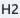
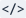
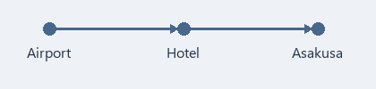

[Markdown 参考指南](https://commonmark.org/help/)

本文档是用于熟悉 Markdown 语法的示例，用 Markdown 整理了与朋友同行的 4 天 3 晚大阪·京都旅行计划。

计划书每个段落正下方的引用框 **[写作提示]** 中，会介绍该段落用到的语法以及在 MDNote 中的操作方法。

# 大阪·京都 4 天 3 晚旅行计划

---

> **[写作提示]**  在行首加上 `#` 即可成为标题。一个 `#` 是最大的标题（H1），最多可使用六个（H6）。在屏幕上，标题左侧会附带与 `#` 数量相同的 `/` 形状竖条，以显示标题的级别。
>
> - 也可以将光标放在段落中，从**标题旁的箭头**里选择 H1~H6。
> - 直接点击按钮本身会应用刚才用过的标题级别，再次点击相同级别则恢复为普通段落。

---

## 1. 时间、同伴与目的地

**11 月 7 日（周六）至 10 日（周二）**，与朋友的*大阪·京都*之旅。第一天~~一到就去购物~~先去住宿处寄存行李。京都避开周末，定在**周一**前往。

京都红叶从 11 月中旬起进入全盛期，此时刚开始变红。最后一天上午要赶往机场，实际能游览的时间只有**两天半**。每天不要安排太多景点！

---

> **[写作提示]**    用符号将文字像 `**粗体**`、`*斜体*`、`~~删除线~~` 这样括起来，就会呈现出上面句子的样式。
>
> - 也可以选中文字后点击**粗体**、**斜体**、**删除线**按钮。
> - 如果没有选中文字，则会应用到接下来输入的文字上。

在粗体、斜体、删除线、行内代码内按 Enter 换行时，两行都会保持原有格式。

---

## 2. 行李物品

先准备好护照、手机这类**一旦忘带就会立刻陷入麻烦的物品**。

- 护照（确认有效期覆盖返程日期）
- 手机
  - eSIM（出发前提前开通）
  - 充电宝（禁止托运，只能随身携带登机）
  - 转换插头（日本为 A 型双平脚插座，100V）
- 支付方式
  - 2 张支持境外支付的银行卡
  - 2~3 万日元现金
  - 零钱包（100 日元、500 日元硬币很快就会攒下一堆）
- 适合步行的舒适运动鞋
- 折叠伞、薄外套（京都 11 月早晨气温只有个位数）

---

> **[写作提示]**  在行首输入 `-` 并加上一个半角空格（或 Tab），就会变成项目符号列表（全角空格不会变成列表）。在前面多加两个空格，就会成为缩进一级的子项。
>
> - 可在**列表旁的箭头**中选择项目符号列表和编号列表。直接点击按钮本身会插入上次使用的列表样式，按钮图标会显示当前是哪种列表。
> - **Tab** 为缩进一级，**Shift+Tab** 为减少缩进一级。
> - 在空列表项中按 **Enter**，会在同一级新增一个空列表项。按一次 **Backspace** 删除列表标记，按两次连同缩进一起删除。

---

## 3. 出发前待办

- [x] 预订机票（仁川 ↔ 关西）
- [x] 预订难波住宿
- [ ] 注册 Visit Japan Web，截图保存入境与海关二维码界面
- [ ] 购买旅行保险
- [ ] 购买并开通 eSIM
- [ ] 在手机钱包中添加 ICOCA（交通卡）
- [ ] 准备日元现金

---

> **[写作提示]**  `- [ ] ` 是空复选框，`- [x] ` 是已勾选的复选框。
>
> - 点击**待办**按钮也可以创建。
> - 在阅读界面和编辑界面中，都可以点击复选框来切换完成状态。需要按 **Ctrl+S** 保存才会保留在文件中。

---

## 4. 出发当天

1. 起飞前 2 个半小时到达仁川机场
2. 托运行李并办理出境审查
3. 关西机场入境审查（凭一个 Visit Japan Web 二维码即可通过入境和海关）
4. 乘坐南海电铁 Rapi:t 约 35 分钟到达难波，去住宿处寄存行李
5. 在道顿堀散步并吃晚餐

---

> **[写作提示]**  在行首像 `1.` 这样输入数字和点号并空一格，就会变成编号列表。
>
> - 也可以从**列表旁的箭头**中选择编号列表。

---

## 5. 行程一览

| 日期 | 上午 | 下午 | 备注 |
| :---: | --- | --- | --- |
| 第 1 天（11/7 周六） | 抵达关西 | 办理入住、道顿堀 | 机场 → 难波 |
| 第 2 天（11/8 周日） | 大阪城 | 黑门市场、心斋桥 | 大阪市内 |
| 第 3 天（11/9 周一） | 伏见稻荷 | 锦市场、祇园 | 京都一日游 |
| 第 4 天（11/10 周二） | 退房 | 关西出发 | 确认免税退税 |

表格里只写大致动线，经常变动的具体安排在下方另外记录。

---

> **[写作提示]**  单元格用 `|` 分隔（两端外侧的 `|` 可省略），在第一行下方加入 `---` 行，第一行就会成为表头。像 `:---:` 这样两侧都加 `:` 的列会居中对齐。
>
> - 也可以点击**表格**并指定列数和行数。上面的表格是 4 列 5 行。
> - 将光标放在表格内会出现表格工具栏，包含左对齐、居中对齐、右对齐、 **添加行**、 **删除行**、 **添加列**、 **删除列**、 **删除表格**、在下方添加段落、缩进/减少缩进。
>
> 生成的表格第二行（`---`）无法在编辑界面中直接修改，因此列对齐方式需通过表格工具栏的对齐按钮（或源码界面）修改。在单元格内输入 `|` 会自动变为 `\|`，而在 `代码` 内则会原样保留。
>
> 在表格内按 Tab/Shift+Tab 会移动到下一/上一单元格并选中其中的文字，在最后一个单元格按 Tab 会新增一行。选中单元格或文字后按 Tab 不会删除文字，只会移动光标。
>
> 选中部分单元格删除时只会清除单元格内容并保留表格，但如果选中整个表格或按 Ctrl+A 全选后删除，则会删除整个表格。

---

## 6. 住宿与交通

住宿定在难波站附近的商务酒店。从机场坐电车可一趟直达，去京都也很方便。

### 6-1. 住宿

- 从难波站步行 5 分钟
- 住 3 晚，不含早餐
- 双床房，2 人 1 间

#### 办理入住时需确认

- 15 点入住，10 点退房（各酒店在 10~11 点之间，需再次查看预订确认单）
- 如果到得早，先把行李寄存在前台
- 大阪住宿税每人每晚 200 日元，退房时另行支付

### 6-2. 从机场到住宿处

- 南海电铁 Rapi:t：约 35 分钟，1,670 日元（全席指定席）
- 南海机场急行：约 45 分钟，970 日元（行李少的话坐这个）

票价是 2026 年 10 月查询的<span style="color:#B91C1C">预估金额</span>，当天需在车站再次确认。

---

> **[写作提示]**  文字颜色写作 `<span style="color:#B91C1C">文字</span>`，在 `#B91C1C` 的位置填入所需的颜色值。
>
> - 选中文字后在**文字颜色**中选择颜色，就会自动插入这种格式。
> - 整个文档的默认文字颜色可在视图菜单中另外设置。

---

### 6-3. 京都游览日（11/9 周一）

全天都要步行，务必穿舒适的鞋子。伏见稻荷从 10 点起就会拥挤，要趁早出发。

#### 当天顺序

1. 7 点从住宿处出发，乘御堂筋线到梅田 → 换乘 JR 新快速到京都站（约 1 小时）
2. 乘 JR 奈良线到稻荷站，8 点前到达伏见稻荷
   - 到山顶往返需 2~3 小时，只爬到四辻展望台即可
   - 午餐在锦市场解决
3. 下午在祇园散步
4. 傍晚返回大阪（阪急京都河原町 → 梅田）

##### 第一站：伏见稻荷

- 8 点前人少，适合拍照
- 爬到四辻再下来大约需要 1~1.5 小时

###### 务必注意！市场与街巷礼仪

- 锦市场禁止边走边吃，在店门口吃完再走
- 祇园南侧的私人小巷禁止拍照（花见小路主干道可以拍）

---

> **[写作提示]**  从 `###`（H3）到 `######`（H6）逐级降低标题级别，可以在大行程下细分具体内容。在编号列表中嵌套项目符号列表时，需要在前面加三个空格。

---

## 7. 预算估算

宽裕估算的**人均预计费用**。受汇率和预订时间影响会有所变动，每次付款后修改为实际金额。

| 项目 | 人均预计 | 2 人合计 | 备注 |
| --- | ---: | ---: | :--- |
| 机票（往返） | 约 30 万韩元 | 约 60 万韩元 | 廉航，含出境税 |
| 住宿（3 晚） | 约 22.5 万韩元 | 约 45 万韩元 | 2 人 1 间每晚约 15 万韩元 |
| 餐饮（4 天） | 约 20 万韩元 | 约 40 万韩元 | 每天约 6,000 日元 |
| 交通 | 约 5 万韩元 | 约 10 万韩元 | 含机场往返、京都往返 |
| 门票·体验 | 约 3 万韩元 | 约 6 万韩元 | 大阪城 1,200 日元，游船 2,000 日元 |
| 伴手礼·机动 | 约 10 万韩元 | 约 20 万韩元 | 留出余量 |
| **合计** | **约 90.5 万韩元** | **约 181 万韩元** | |

---

> **[写作提示]** 在源码中，表格对齐方式通过在第二行添加 `:` 来表示（`---:` 为右对齐，`:---` 为左对齐，`:---:` 为居中对齐）。由于在编辑界面中无法直接修改第二行，请使用表格工具栏的左、居中、右对齐按钮（或源码界面）来更改对齐方式。在单元格内也可以使用 `**粗体**` 等样式。

---

## 8. 想去的地方

在当地如果时间充裕可以逐一顺道造访的地方。

- 大阪
  | 地点 | 预计用时 | 时间段 |
  | --- | ---: | --- |
  | 大阪城天守阁 | 约 1 小时 30 分钟 | 上午（9 点开馆） |
  | 黑门市场 | 约 1 小时 | 午餐前 |
  | 道顿堀观光游船 | 约 20 分钟 | 傍晚 |
- 京都
  - 伏见稻荷（趁早前往）
  - 锦市场小吃
  - 祇园街区的抹茶甜点
- 要买的伴手礼
  - 分给家人和朋友的点心
  - 药妆店常备药

黑门市场面向游客价格偏高，务必看清标价再买。去餐厅前先在地图应用上再次确认营业时间和休息日！

---

> **[写作提示]** 在表格每一行前面加上两个空格，就会变成嵌套在紧邻的上一列表项中的表格。
>
> - 点击表格工具栏的**缩进**按钮，表格就会移入紧邻的上一列表项内。

---

## 9. 和朋友定下的约定

> 与其把行程排满，不如每天至少去咖啡馆休息一次。
>
> 下雨就改成以室内为主，不要勉强赶行程。

> [!WARNING] 护照
> 出发前务必确认有效期还剩 6 个月以上！

---

> **[写作提示]**  在行首加上 `> ` 就会变成引用。在引用内分段时，插入只有 `>` 的一行即可。
>
> - 也可以选中段落后点击**引用**。同时选中普通段落和引用时会全部应用引用，再次点击则取消引用。
> - 在引用的第一行输入 `[!NOTE]`、`[!TIP]`、`[!IMPORTANT]`、`[!WARNING]`、`[!CAUTION]` 之一，就会变成像上面“护照”那样带有彩色竖条和图标的提示框。在标记后面输入文字，该文字会成为标题；如果不输入，则会像“Warning”一样以类型名称作为标题。这也是 GitHub 和 Obsidian 使用的语法。

---

## 10. 预订编号与参考网站

[Visit Japan Web](https://www.vjw.digital.go.jp/)

[日本国家旅游局](https://www.japan.travel/)

[京都旅游官方指南](https://kyoto.travel/cn/)

住宿预订编号为 `OSAKA-EXAMPLE-2026`。已确定的事项标上 `已预订`，需要进一步了解的事项标上 `待确认`。

---

> **[写作提示]**  链接写作 `[显示文字](地址)`。也可以选中文字后点击**链接**并输入地址。
>
> - 编辑时按住 **Ctrl** 并点击链接即可打开。在阅读模式下直接点击即可。
>
>  用 `` ` `` 符号将文字括起来，就会像 `待确认` 一样，变成保持正文字体不变但有所区分的**行内代码**。

---

## 11. 汇率与免税备忘

用于购物时直接换算成韩元的备忘。汇率按 **100 日元 = 约 850 韩元**（2026 年 10 月初）计算。

```text
韩元 = 日元 × 8.5
例）1,000 日元 × 8.5 = 约 8,500 韩元
例）5,000 日元 × 8.5 = 约 42,500 韩元
```

自 2026 年 11 月起，免税改为先按含税价付款，出境时经海关确认后再退还税款的方式。小票和购买的物品在出境前请原样保留。

---

> **[写作提示]**  在内容上下各加一行 ```` ``` ```` 即可成为代码块。可以像开头行的 `text` 一样在后面写上语言名称。
>
> - 也可以选中段落后点击**代码**。在代码块内再次点击，会保留内容并恢复为普通段落。
> - 代码块内不会应用粗体等样式。

---

## 12. 移动路线

和朋友一起查看的移动顺序图。



---

> **[写作提示]**  图片通过 `` 插入，形式上就是在链接前面加上 `!`。
>
> - 可以点击**图片**按钮或按 **Ctrl+Shift+I**，也可以将图片文件拖放到编辑窗口中。
> - 请将图片文件放在与 MD 文件相同的文件夹或其子文件夹中，并使用文件名或类似 `图片/地图.png` 这样相对于 MD 文件位置的路径。
> - 这样一来，迁移到其他电脑时只需将 MD 文件和图片文件夹一起移动，图片就能正常显示。如果写成 `C:\Users\...` 这样从盘符开始的路径，在其他电脑上将找不到图片。

---

## 13. 旅行归来后的待办

回来后根据银行卡账单和小票结清账目，并把觉得不错的地方也补记到这个文件里。

- [ ] 结算开销并与预算表对比
- [ ] 标记想再去的地方
- [ ] 决定下一次旅行的日期

---

> **[写作提示]** 在编辑界面的默认模式下，整个画面会隐藏 `**` 或 `#` 等符号，只显示修饰后的样式。开启视图 → 实时模式后，仅光标所在行（及所选行）会变为显示符号的源文本，便于修改（初始为关闭状态，更改后的模式下次仍会记住）。点击格式工具栏最右侧的  **源码**按钮，即可原样显示整个文档的所有符号。
>
> - **Ctrl+S** 为保存，**Ctrl+Z** 为撤销，**Ctrl+Y** 为重做。连续输入的文字会一次性撤销，而移动光标或执行 Delete、粘贴、命令操作则会分为新的步骤。
> - 程序使用方法位于**帮助 → MDNote使用说明**中。