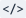
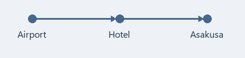

[Markdown 參考指南](https://commonmark.org/help/)

本文件是為了熟悉 Markdown 語法而設計的範例，用 Markdown 整理了與朋友同行的4天3夜大阪、京都旅遊計畫。

每個行程段落正下方的引用框 **[寫作提示]** 中，會說明該段落使用的語法以及在 MDNote 中的建立方式。

# 大阪、京都 4天3夜旅遊計畫

---

> **[寫作提示]**  在行首加上 `#` 即可設為標題。一個 `#` 是最大的標題（H1），最多可使用六個（H6）。
>
> - 也可以將游標放在段落中，從**標題旁的箭頭**選擇 H1～H6。
> - 直接按按鈕本身會套用剛才用過的標題層級，再按一次相同層級則會回到一般段落。

---

## 1. 時間、旅伴與目的地

**11月7日（六）至10日（二）**，和朋友的*大阪、京都*之旅。第一天~~一抵達就去逛街~~先到飯店寄放行李。京都避開週末，改在**星期一**前往。

京都紅葉從11月中旬開始進入最美時期，這時候才剛開始轉紅。最後一天上午就得前往機場，實際能遊玩的時間只有**兩天半**，每天的行程不要排太滿！

---

> **[寫作提示]**    將文字像 `**粗體**`、`*斜體*`、`~~刪除線~~` 這樣用符號包起來，就會呈現如上方句子的樣式。
>
> - 也可以選取文字後，按下**粗體**、**斜體**、**刪除線**按鈕。
> - 若未選取文字，樣式會套用到接下來輸入的文字。

在粗體、斜體、刪除線、行內程式碼內按 Enter 換行時，兩行都會維持原本的格式。

---

## 2. 必帶物品

先從護照、手機這類**沒帶就會立刻出問題的物品**開始準備。

- 護照（確認效期到回國當天仍有效）
- 手機
  - eSIM（出國前先開通）
  - 行動電源（禁止託運，僅能隨身攜帶上機）
  - 雙平腳轉接頭（日本為 A 型雙平腳插座、100V）
- 付款工具
  - 可海外刷卡的信用卡 2 張
  - 日幣現金 2～3 萬日圓
  - 零錢包（100 日圓、500 日圓硬幣很快就會累積一堆）
- 好走的運動鞋
- 折疊傘、薄外套（京都 11 月早晨氣溫只有個位數）

---

> **[寫作提示]**  在行首輸入 `-` 並加上一個半形空白（或 Tab），就會變成項目符號清單（全形空白不會變成清單）。在前方多加兩個空白，就會變成往內一層的子項目。
>
> - 從**清單旁的箭頭**可選擇項目符號清單與編號清單。直接按按鈕本身會套用上次使用的清單樣式，按鈕圖示也會顯示目前的清單類型。
> - **Tab** 可縮排一層，**Shift+Tab** 可凸排一層。
> - 在空白項目按 **Enter** 會在同一層新增一個空白項目。按一下 **Backspace** 會刪除清單標記，按兩下則連同縮排一併刪除。

---

## 3. 出發前待辦事項

- [x] 預訂機票（仁川 ↔ 關西）
- [x] 預訂難波住宿
- [ ] 登錄 Visit Japan Web，並將入境、海關 QR 畫面截圖保存
- [ ] 投保旅遊平安險
- [ ] 購買並開通 eSIM
- [ ] 在手機錢包加入 ICOCA（交通卡）
- [ ] 準備日幣現金

---

> **[寫作提示]**  `- [ ] ` 是未勾選方塊，`- [x] ` 是已勾選方塊。
>
> - 也可以按**待辦**按鈕建立。
> - 在閱讀畫面與編輯畫面中，都可以點選方塊切換完成狀態。切換後須按 **Ctrl+S** 儲存才會寫入檔案。

---

## 4. 出發當天

1. 起飛前 2 個半小時抵達仁川機場
2. 託運行李與出境審查
3. 關西機場入境審查（憑一個 Visit Japan Web QR 即可通過入境與海關）
4. 搭乘南海電鐵 Rapi:t 前往難波約 35 分鐘，到飯店寄放行李
5. 散步逛道頓堀並享用晚餐

---

> **[寫作提示]**  在行首輸入如 `1.` 的數字加句點並空一格，就會變成編號清單。
>
> - 也可以從**清單旁的箭頭**選擇編號清單。

---

## 5. 行程總覽

| 日期 | 上午 | 下午 | 備註 |
| :---: | --- | --- | --- |
| 第1天 (11/7 六) | 抵達關西 | 辦理入住、道頓堀 | 機場 → 難波 |
| 第2天 (11/8 日) | 大阪城 | 黑門市場、心齋橋 | 大阪市區 |
| 第3天 (11/9 一) | 伏見稻荷 | 錦市場、祇園 | 京都一日遊 |
| 第4天 (11/10 二) | 退房 | 關西起飛 | 確認免稅退稅 |

表格只放主要動線，常變動的細部行程另外寫在下方。

---

> **[寫作提示]**  儲存格以 `|` 分隔（兩端外側的 `|` 可省略），在第一列下方加入 `---` 列，第一列就會成為標題列。像 `:---:` 這樣兩側都加上 `:` 的欄位會置中對齊。
>
> - 也可以按**表格**並指定欄數與列數。上方表格為 4 欄、5 列。
> - 將游標放在表格內就會顯示表格工具列，包含靠左、置中、靠右對齊、 **新增列**、 **移除列**、 **新增欄**、 **移除欄**、 **刪除表格**、在下方新增段落、縮排與凸排。
>
> 建立好的表格第二列（`---`）無法在編輯畫面中直接修改，因此欄位對齊方式需透過表格工具列的對齊按鈕（或原始碼畫面）變更。在儲存格內輸入 `|` 會自動變成 `\|`，而在 `程式碼` 內則會原樣保留。
>
> 在表格內按 Tab/Shift+Tab 會選取下一格／上一格的文字並移動，在最後一格按 Tab 則會新增一列。選取儲存格或文字後按 Tab 不會刪除文字，只會移動游標。
>
> 選取部分儲存格並刪除時，只會清除儲存格內容並保留表格；但若選取整個表格或按 Ctrl+A 全選後刪除，則會刪除整個表格。

---

## 6. 住宿與交通

住宿決定選難波站附近的商務飯店。從機場搭電車一班就能到，去京都也很方便。

### 6-1. 住宿

- 距離難波站步行 5 分鐘
- 住 3 晚，不含早餐
- 雙人房，兩張單人床

#### 辦理入住時確認事項

- 15 點入住、10 點退房（每間飯店為 10～11 點不等，需再確認訂房確認單）
- 若提早抵達，先到櫃檯寄放行李
- 大阪住宿稅每人每晚 200 日圓，退房時另外支付

### 6-2. 從機場到飯店

- 南海電鐵 Rapi:t：約 35 分鐘，1,670 日圓（全車對號座）
- 南海機場急行：約 45 分鐘，970 日圓（行李少的話搭這個）

車資是 2026 年 10 月查到的<span style="color:#B91C1C">預估金額</span>，當天在車站要再次確認。

---

> **[寫作提示]**  文字色彩的寫法為 `<span style="color:#B91C1C">文字</span>`，在 `#B91C1C` 的位置填入所需的色碼。
>
> - 選取文字並從**文字色彩**挑選顏色，就會自動填入這個格式。
> - 整份文件的預設文字色彩可在檢視選單中另外設定。

---

### 6-3. 前往京都當天 (11/9 一)

這天要走一整天，一定要穿好走的鞋。伏見稻荷 10 點過後人潮就會變多，要一早出發。

#### 當日流程

1. 7 點從飯店出發，搭御堂筋線到梅田 → 搭 JR 新快速到京都站（約 1 小時）
2. 轉乘 JR 奈良線到稻荷站，8 點前抵達伏見稻荷
   - 攻頂來回要 2～3 小時，只走到四辻展望台就好
   - 午餐在錦市場解決
3. 下午漫步祇園
4. 晚上返回大阪（阪急京都河原町 → 梅田）

##### 第一站：伏見稻荷

- 8 點前人比較少，好拍照
- 走到四辻再下山約需 1～1 個半小時

###### 務必注意！市場與巷弄禮儀

- 錦市場禁止邊走邊吃，要在店門口吃完再離開
- 祇園南側的私人巷弄禁止攝影（花見小路主幹道可以拍）

---

> **[寫作提示]**  從 `###`（H3）到 `######`（H6）依序往下使用標題層級，就能在大行程底下細分內容。在編號清單內加入項目符號清單時，前方要加三個空白。

---

## 7. 預估預算

寬裕抓出的**每人預估費用**。實際金額會依匯率與預訂時間而異，每次付款後再改為實際金額。

| 項目 | 每人預估 | 2人合計 | 備註 |
| --- | ---: | ---: | :--- |
| 機票（來回） | 約 30 萬韓元 | 約 60 萬韓元 | 廉航，含出境稅 |
| 住宿（3晚） | 約 22 萬 5 千韓元 | 約 45 萬韓元 | 雙人房每晚約 15 萬韓元 |
| 餐費（4天） | 約 20 萬韓元 | 約 40 萬韓元 | 每天約 6,000 日圓 |
| 交通 | 約 5 萬韓元 | 約 10 萬韓元 | 含機場來回、京都來回 |
| 門票、體驗 | 約 3 萬韓元 | 約 6 萬韓元 | 大阪城 1,200 日圓、觀光船 2,000 日圓 |
| 伴手禮、預備金 | 約 10 萬韓元 | 約 20 萬韓元 | 抓寬裕一點 |
| **合計** | **約 90 萬 5 千韓元** | **約 181 萬韓元** | |

---

> **[寫作提示]** 在原始碼中，表格對齊方式是在第二列加上 `:` 來表示（`---:` 為靠右對齊、`:---` 為靠左對齊、`:---:` 為置中對齊）。由於在編輯畫面中無法直接修改第二列，請使用表格工具列的靠左、置中、靠右對齊按鈕（或原始碼畫面）變更對齊方式。儲存格內同樣可以使用 `**粗體**` 等樣式。

---

## 8. 想去的景點

在當地若有空檔，可以逐一造訪的地方。

- 大阪
  | 地點 | 預估時間 | 時段 |
  | --- | ---: | --- |
  | 大阪城天守閣 | 約 1 小時 30 分鐘 | 上午（9點開館） |
  | 黑門市場 | 約 1 小時 | 午餐前 |
  | 道頓堀觀光船 | 約 20 分鐘 | 晚上 |
- 京都
  - 伏見稻荷（趁早前往）
  - 錦市場美食
  - 祇園街道品嚐抹茶甜點
- 必買伴手禮
  - 分送給家人、朋友的點心
  - 藥妝店常備藥

黑門市場因為針對觀光客，價格偏高，買之前一定要先看清楚標價。去餐廳前也要先在地圖 App 上再次確認營業時間與公休日！

---

> **[寫作提示]** 在表格每一列前方加上兩個空白，就會變成縮排在正上方清單項目內的表格。
>
> - 按下表格工具列的**縮排**按鈕，表格就會縮排至正上方的清單項目內。

---

## 9. 與朋友的約定

> 與其把行程塞滿，不如每天至少找一家咖啡廳坐下來休息。
>
> 下雨就改成室內行程為主，不要勉強。

---

> **[寫作提示]**  在行首加上 `> ` 就會變成引用段落。在引用內要分段時，可插入只有 `>` 的一行。
>
> - 也可以選取段落後按下**引用**。若同時選取一般段落與引用段落，會全部套用為引用；再按一次則會取消。

---

## 10. 訂房編號與參考網站

[Visit Japan Web](https://www.vjw.digital.go.jp/)

[日本國家旅遊局](https://www.japan.travel/)

[京都旅遊官方指南](https://kyoto.travel/tw/)

住宿預訂編號為 `OSAKA-EXAMPLE-2026`。已確定的事項標上 `預約完成`，需要再查詢的事項則標上 `待確認`。

---

> **[寫作提示]**  連結的寫法為 `[顯示文字](網址)`。也可以選取文字後按下**連結**並填入網址。
>
> - 編輯中按住 **Ctrl** 並點選連結即可開啟；在閱讀模式中直接點選即可。
>
>  用 `` ` `` 符號將文字包起來，就會像 `待確認` 一樣，維持內文字型但做出區隔，成為**行內程式碼**。

---

## 11. 匯率與免稅筆記

逛街時用來快速換算韓元金額的筆記。匯率以 **100 日圓 = 約 850 韓元**（2026 年 10 月初）計算。

```text
韓元 = 日圓 × 8.5
例）1,000 日圓 × 8.5 = 約 8,500 韓元
例）5,000 日圓 × 8.5 = 約 42,500 韓元
```

自 2026 年 11 月起，免稅改為先以含稅金額結帳，出境時經海關確認後再辦理退稅。收據與購買的商品在出境前都要妥善保留。

---

> **[寫作提示]**  在內容上下各加一行 ```` ``` ````，就會變成程式碼區塊。也可以像開頭行的 `text` 一樣，在後面寫上語言名稱。
>
> - 也可以選取段落後按下**程式碼**。在區塊內再按一次，會保留內容並變回一般段落。
> - 程式碼區塊內不會套用粗體等文字樣式。

---

## 12. 移動路線

要和朋友一起看的移動順序圖。



---

> **[寫作提示]**  圖片的寫法為 ``，也就是在連結前面加上 `!` 的形式。
>
> - 可以按**圖片**按鈕或 **Ctrl+Shift+I**，也可以直接把圖片檔拖放到編輯視窗中。
> - 請將圖片檔放在與 MD 檔案相同的資料夾或子資料夾下，並使用檔案名稱或像 `圖片/地圖.png` 這樣相對於 MD 檔案位置的路徑。
> - 這樣一來，移到其他電腦時只要把 MD 檔案和圖片資料夾一起搬過去，圖片就能正常顯示。若寫成 `C:\Users\...` 這種從磁碟機開始的完整路徑，換到其他電腦就會找不到圖片。

---

## 13. 回國後待辦事項

回國後用刷卡明細和收據結算花費，並把覺得不錯的地方也補記在這份檔案裡。

- [ ] 結算旅費並與預算表比對
- [ ] 標記想再去的地方
- [ ] 決定下一次旅行的日期

---

> **[寫作提示]** 在編輯畫面的基本模式中，整個畫面會隱藏 `**` 或 `#` 等符號，只顯示套用格式後的樣貌。開啟檢視 → 即時模式後，只有游標所在行（及選取的行）會變成顯示符號的原始文字，方便修改（初始為關閉狀態，變更後的模式下次仍會記住）。按下格式工具列最右側的  **原始碼**按鈕，就能連同整份文件的符號一併顯示。
>
> - **Ctrl+S** 為儲存，**Ctrl+Z** 為復原，**Ctrl+Y** 為重做。連續輸入的文字會一次復原，而移動游標或執行 Delete、貼上、命令操作時則會分為新的步驟。
> - 程式的操作方式請參閱**說明 → MDNote使用說明**。