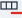
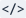
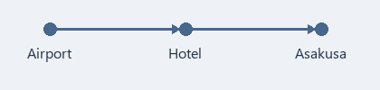

[마크다운 참고 안내](https://commonmark.org/help/)

이 문서는 Markdown 문법을 익히기 위한 예제입니다. 친구와 떠나는 오사카·교토 3박 4일 여행 계획을 Markdown으로 정리했습니다.

계획서 문단마다 바로 아래 인용 상자 **[작성 팁]**에서 그 문단에 쓴 문법과 MDNote에서 만드는 방법을 설명합니다.

# 오사카·교토 3박 4일 여행 계획

---

> **[작성 팁]**  줄 앞에 `#`을 붙이면 제목이 됩니다. `#` 하나는 가장 큰 제목(H1)이고, 여섯 개(H6)까지 쓸 수 있습니다. 화면에서는 제목 왼쪽에 `#` 개수만큼 `/` 모양 막대가 붙어 제목 단계를 보여 줍니다.
>
> - 문단에 커서를 놓고 **제목 옆 화살표**에서 H1~H6를 골라도 됩니다.
> - 버튼 자체를 누르면 방금 쓴 제목 단계가 그대로 들어가고, 같은 단계를 한 번 더 누르면 일반 문단으로 돌아옵니다.

---

[TOC]

---

> **[작성 팁]** 한 줄에 `[TOC]`만 쓰면 그 자리에 위와 같은 목차가 생깁니다. 제목을 고치면 목차도 따라 바뀌고, 목차 항목을 누르면 그 제목으로 갑니다.

---

## 1. 언제, 누구와, 어디로

**11월 7일(토)부터 10일(화)까지**, 친구와 *오사카·교토* 여행. 첫날은 ~~도착하자마자 쇼핑~~ 숙소에 짐부터 맡기기. 교토는 주말을 피해 **월요일**에 가기.

교토 단풍은 11월 중순부터 절정[^1]이라 이때는 막 물들기 시작하는 시기. 마지막 날은 ==오전에 공항으로== 가야 하니 실제로 돌아다닐 수 있는 건 **이틀 반**뿐. 하루에 갈 곳을 너무 많이 넣지 말 것!

[^1]: 해마다 조금씩 다르니 출발 전에 단풍 예보를 확인하기.

---

> **[작성 팁]**    글자를 `**굵게**`, `*기울임*`, `~~취소선~~`처럼 기호로 감싸면 위 문장처럼 꾸며집니다.
>
> - 글자를 선택하고 **굵게**, **기울임**, **취소선** 버튼을 눌러도 됩니다.
> - 선택한 글자가 없으면 그다음에 입력하는 글자에 적용됩니다.
>
>  글자를 `==형광펜==`처럼 `==`로 감싸면 위의 "오전에 공항으로"처럼 노란 배경이 칠해집니다. **형광펜** 버튼이나 **Ctrl+Shift+H**로도 넣을 수 있습니다.
>
> 본문에 `[^1]`을 쓰고 아래에 `[^1]: 설명`을 따로 적으면 **각주**가 됩니다. 위 "절정" 옆 번호에 마우스를 올리면 설명이 보이고, 설명 끝의 ↩를 누르면 본문으로 돌아갑니다.

굵게·기울임·취소선·인라인 코드 안에서 Enter를 치면 줄이 바뀌어도 두 줄 모두 서식이 유지됩니다.

---

## 2. 가져갈 것

여권, 휴대전화처럼 **없으면 바로 곤란한 것**부터 챙기기.

- 여권 (돌아오는 날까지 유효한지 확인)
- 휴대전화
  - eSIM (출국 전에 미리 개통)
  - 보조 배터리 (위탁 수하물 금지, 기내에만)
  - 돼지코 변환 플러그 (일본은 A형 11자 콘센트, 100V)
- 결제 수단
  - 해외 결제 되는 카드 2장
  - 현금 2~3만 엔
  - 동전 지갑 (100엔·500엔 동전이 금방 쌓임)
- 걷기 편한 운동화
- 접이식 우산, 얇은 겉옷 (교토 11월 아침은 한 자릿수 기온)

---

> **[작성 팁]**  줄 앞에 `-`를 쓰고 반각 공백 한 칸(또는 Tab)을 띄우면 글머리 기호 목록이 됩니다(전각 공백은 목록이 되지 않습니다). 앞에 공백 두 칸을 더 넣으면 한 단계 안쪽 항목이 됩니다.
>
> - **목록 옆 화살표**에서 글머리 기호 목록과 번호 목록을 고를 수 있습니다. 버튼 자체를 누르면 마지막에 쓴 목록이 들어가고, 지금 어떤 목록인지 아이콘 모양으로 보여 줍니다.
> - **Tab**은 한 단계 들여쓰기, **Shift+Tab**은 한 단계 내어쓰기입니다.
> - 빈 항목에서 **Enter**를 누르면 같은 단계에 빈 항목이 하나 더 생깁니다. **Backspace**를 한 번 누르면 목록 표시가, 두 번 누르면 들여쓰기까지 지워집니다.

---

## 3. 출발 전에 할 일

- [x] 항공권 예약 (인천 ↔ 간사이)
- [x] 난바 숙소 예약
- [ ] Visit Japan Web 등록, 입국·세관 QR 화면 캡처해 두기
- [ ] 여행자 보험 가입
- [ ] eSIM 구매·개통
- [ ] 휴대전화 지갑에 ICOCA(교통카드) 추가
- [ ] 엔화 현금 준비

---

> **[작성 팁]**  `- [ ] `는 빈 상자, `- [x] `는 표시된 상자입니다.
>
> - **체크** 버튼을 눌러도 만들 수 있습니다.
> - 읽기 화면과 수정 화면 모두 상자를 눌러 완료 표시를 바꿀 수 있습니다. **Ctrl+S**로 저장해야 파일에 남습니다.

---

## 4. 출발하는 날

1. 출발 2시간 반 전까지 인천공항 도착
2. 짐 부치고 출국 심사
3. 간사이 공항 입국 심사 (Visit Japan Web QR 하나로 입국·세관 통과)
4. 난카이 라피트로 난바까지 약 35분, 숙소에 짐 맡기기
5. 도톤보리 산책하며 저녁 먹기

---

> **[작성 팁]**  줄 앞에 `1.`처럼 숫자와 점을 쓰고 한 칸 띄우면 번호 목록이 됩니다.
>
> - **목록 옆 화살표**에서 번호 목록을 골라도 됩니다.

---

## 5. 한눈에 보는 일정

| 날짜 | 오전 | 오후 | 비고 |
| :---: | --- | --- | --- |
| 1일차 (11/7 토) | 간사이 도착 | 체크인, 도톤보리 | 공항 → 난바 |
| 2일차 (11/8 일) | 오사카성 | 쿠로몬 시장, 신사이바시 | 오사카 시내 |
| 3일차 (11/9 월) | 후시미이나리 | 니시키 시장, 기온 | 교토 당일치기 |
| 4일차 (11/10 화) | 체크아웃 | 간사이 출발 | 면세 환급 확인 |

표에는 굵직한 동선만. 자주 바뀌는 세부 일정은 아래에 따로 적기.

---

> **[작성 팁]**  칸은 `|`로 나누고(양 끝의 바깥 `|`는 생략 가능), 첫 줄 아래에 `---` 줄을 넣으면 첫 줄이 제목 행이 됩니다. `:---:`처럼 양쪽에 `:`를 붙인 칸은 가운데 정렬입니다.
>
> - **표**를 누르고 열과 행 수를 정해도 됩니다. 위 표는 열 4개, 행 5개입니다.
> - 표 안에 커서를 놓으면 표 도구 줄이 나타납니다. 왼쪽·가운데·오른쪽 정렬,  **행 추가**,  **행 제거**,  **열 추가**,  **열 제거**,  **표 삭제**, 아래 문단 추가, 들여쓰기·내어쓰기가 있습니다.
>
> 만든 표의 둘째 줄(`---`)은 수정 화면에서 직접 고칠 수 없으므로, 열 정렬은 표 도구 줄의 정렬 버튼(또는 원문 화면)으로 바꿉니다. 칸 안에 `|`를 치면 자동으로 `\|`로 들어가고, `코드` 안에서는 그대로 유지됩니다.
>
> 표 안에서 Tab/Shift+Tab을 누르면 다음/이전 칸의 글자를 선택하며 이동하고, 마지막 칸에서 Tab을 누르면 새 행이 추가됩니다. 칸이나 글자를 선택한 채 Tab을 누르면 글자를 지우지 않고 이동만 합니다.
>
> 일부 칸을 선택해 지우면 칸 내용만 지워지고 표는 유지되지만, 표 전체나 Ctrl+A로 선택해 지우면 표 자체가 지워집니다.

---

## 6. 숙소와 교통

숙소는 난바역 근처 비즈니스호텔로 결정. 공항에서 전철 한 번에 오고, 교토 가는 길도 편함.

### 6-1. 숙소

- 난바역에서 걸어서 5분
- 3박, 조식 없음
- 2인 1실, 트윈 침대

#### 체크인할 때 확인할 것

- 체크인 15시, 체크아웃 10시 (호텔마다 10~11시라 예약 확인서 다시 보기)
- 일찍 도착하면 프런트에 짐만 먼저 맡기기
- 오사카 숙박세 1인 1박 200엔, 체크아웃 때 따로 냄

### 6-2. 공항에서 숙소까지

- 난카이 라피트: 약 35분, 1,670엔 (전 좌석 지정석)
- 난카이 공항급행: 약 45분, 970엔 (짐이 적으면 이걸로)

요금은 2026년 10월에 찾아본 <span style="color:#B91C1C">예상 금액</span>이니 당일 역에서 다시 확인할 것.

---

> **[작성 팁]**  글자색은 `<span style="color:#B91C1C">글자</span>`처럼 적습니다. `#B91C1C` 자리에 원하는 색 값을 넣습니다.
>
> - 글자를 선택하고 **글자색**에서 색을 고르면 이 모양이 자동으로 들어갑니다.
> - 문서 전체의 기본 글자색은 보기 메뉴에서 따로 정합니다.

---

### 6-3. 교토 가는 날 (11/9 월)

하루 종일 걷는 날이라 편한 신발 필수. 후시미이나리는 10시부터 붐비니 아침 일찍 움직이기.

#### 하루 순서

1. 7시 숙소 출발, 미도스지선으로 우메다 → JR 신쾌속으로 교토역 (약 1시간)
2. JR 나라선으로 이나리역, 8시 전 후시미이나리 도착
   - 정상까지는 왕복 2~3시간이라 요츠츠지 전망대까지만
   - 점심은 니시키 시장에서
3. 오후에 기온 산책
4. 저녁에 오사카로 돌아오기 (한큐 교토카와라마치 → 우메다)

##### 첫 코스: 후시미이나리

- 8시 전에는 사람이 적어서 사진 찍기 좋음
- 요츠츠지까지 올라갔다 내려오는 데 1시간~1시간 반

###### 반드시 주의! 시장·골목 예절

- 니시키 시장은 걸으면서 먹기 금지, 가게 앞에서 먹고 이동
- 기온 남쪽 사설 골목은 촬영 금지 (하나미코지 큰길은 괜찮음)

---

> **[작성 팁]**  `###`(H3)부터 `######`(H6)까지 제목 단계를 내려 가면 큰 일정 아래 세부 내용을 나눌 수 있습니다. 번호 목록 안에 글머리 기호 목록을 넣을 때는 앞에 공백 세 칸을 넣습니다.

---

## 7. 예상 예산

넉넉하게 잡은 **1인 기준 예상 비용**. 환율과 예약 시점에 따라 달라지니 결제할 때마다 실제 금액으로 고치기.

| 항목 | 1인 예상 | 2인 합계 | 메모 |
| --- | ---: | ---: | :--- |
| 항공권 (왕복) | 약 30만 원 | 약 60만 원 | LCC, 출국세 포함 |
| 숙소 (3박) | 약 22만 5천 원 | 약 45만 원 | 2인 1실 1박 약 15만 원 |
| 식비 (4일) | 약 20만 원 | 약 40만 원 | 하루 6,000엔 정도 |
| 교통 | 약 5만 원 | 약 10만 원 | 공항 왕복·교토 왕복 포함 |
| 입장료·체험 | 약 3만 원 | 약 6만 원 | 오사카성 1,200엔, 리버크루즈 2,000엔 |
| 기념품·여유 | 약 10만 원 | 약 20만 원 | 넉넉하게 |
| **합계** | **약 90만 5천 원** | **약 181만 원** | |

---

> **[작성 팁]** 원문에서 표 정렬은 둘째 줄에 `:`를 붙여 나타냅니다(`---:`는 오른쪽, `:---`는 왼쪽, `:---:`는 가운데 정렬). 수정 화면에서는 둘째 줄을 직접 고칠 수 없으니 표 도구 줄의 왼쪽·가운데·오른쪽 정렬 버튼(또는 원문 화면)으로 정렬을 바꿉니다. 칸 안에서도 `**굵게**` 같은 꾸밈을 쓸 수 있습니다.

---

## 8. 가 보고 싶은 곳

현지에서 시간이 남으면 하나씩 들를 곳.

- 오사카
  | 장소 | 예상 시간 | 시간대 |
  | --- | ---: | --- |
  | 오사카성 천수각 | 약 1시간 30분 | 오전 (9시 개관) |
  | 쿠로몬 시장 | 약 1시간 | 점심 전 |
  | 도톤보리 리버크루즈 | 약 20분 | 저녁 |
- 교토
  - 후시미이나리 (아침 일찍)
  - 니시키 시장 먹거리
  - 기온 거리에서 말차 디저트
- 사 올 기념품
  - 가족·친구에게 나눠 줄 과자
  - 드러그스토어 상비약

쿠로몬 시장은 관광객용으로 값이 올라서 가격표 꼭 보고 사기. 식당은 가기 전에 지도 앱에서 영업시간·휴무일 다시 확인!

---

> **[작성 팁]** 표의 모든 줄 앞에 공백 두 칸을 넣으면 바로 위 목록 항목 안에 들어간 표가 됩니다.
>
> - 표 도구 줄의 **들여쓰기** 버튼을 누르면 표가 바로 위 목록 항목 안으로 들어갑니다.

---

## 9. 친구와 정한 약속

> 일정을 다 채우기보다, 하루에 한 번은 카페에서 쉬어 가기.
>
> 비가 오면 실내 위주로 바꾸고, 무리하지 말 것.

> [!WARNING] 여권
> 유효기간이 6개월 이상 남았는지 출발 전에 반드시 확인!

---

> **[작성 팁]**  줄 앞에 `> `를 붙이면 인용문이 됩니다. 인용 안에서 문단을 나눌 때는 `>`만 있는 줄을 넣습니다.
>
> - 문단을 선택하고 **인용**을 눌러도 됩니다. 일반 문단과 인용을 함께 선택하면 전체에 적용되고, 다시 누르면 해제됩니다.
> - 인용 첫 줄에 `[!NOTE]`, `[!TIP]`, `[!IMPORTANT]`, `[!WARNING]`, `[!CAUTION]` 중 하나를 쓰면 위의 "여권"처럼 색 막대와 아이콘이 붙은 알림 상자가 됩니다. 표식 뒤에 글을 쓰면 그 글이 제목이 되고, 쓰지 않으면 "Warning"처럼 종류 이름이 제목이 됩니다. GitHub와 옵시디언에서도 쓰는 문법입니다.

---

## 10. 예약 번호와 참고 사이트

[Visit Japan Web](https://www.vjw.digital.go.jp/)

[일본정부관광국 한국어 안내](https://www.japan.travel/ko/kr/)

[교토 여행 공식 안내](https://kyoto.travel/ko/)

숙소 예약 번호는 `OSAKA-EXAMPLE-2026`. 확정된 일에는 `예약 완료`, 더 알아볼 일에는 `확인 필요` 붙여 두기.

---

> **[작성 팁]**  링크는 `[보일 글자](주소)`로 적습니다. 글자를 선택하고 **링크**를 눌러 주소를 넣어도 됩니다.
>
> - 수정 중에는 **Ctrl**을 누른 채 링크를 클릭하면 열립니다. 읽기 모드에서는 그냥 클릭하면 됩니다.
>
>  글자를 `` ` `` 기호로 감싸면 `확인 필요`처럼 본문 글꼴은 그대로 두고 구별되는 **인라인 코드**가 됩니다.

---

## 11. 환율·면세 메모

쇼핑할 때 원화로 얼마인지 바로 계산하기 위한 메모. 환율은 **100엔 = 약 850원**(2026년 10월 초)으로 잡음.

```text
원화 = 엔화 × 8.5
예) 1,000엔 × 8.5 = 약 8,500원
예) 5,000엔 × 8.5 = 약 42,500원
```

2026년 11월부터 면세는 일단 세금 포함으로 결제하고, 출국할 때 세관 확인 뒤 돌려받는 방식. 영수증과 산 물건은 출국 때까지 그대로 두기.

---

> **[작성 팁]**  내용 위아래에 ```` ``` ```` 줄을 하나씩 넣으면 코드 블록이 됩니다. 여는 줄의 `text`처럼 뒤에 언어 이름을 적을 수 있습니다.
>
> - 문단을 선택하고 **코드**를 눌러도 됩니다. 블록 안에서 다시 누르면 내용은 그대로 두고 일반 문단으로 돌아옵니다.
> - 코드 블록 안에서는 굵게 같은 꾸밈이 적용되지 않습니다.

---

## 12. 이동 경로

친구랑 같이 볼 이동 순서 그림.



---

> **[작성 팁]**  그림은 ``으로 넣습니다. 링크 앞에 `!`를 붙인 모양입니다.
>
> - **이미지** 버튼이나 **Ctrl+Shift+I**를 눌러도 되고, 그림 파일을 편집 창에 끌어다 놓아도 됩니다.
> - 그림 파일은 MD 파일과 같은 폴더나 그 아래 폴더에 두고, 파일 이름이나 `그림/지도.png`처럼 MD 파일 위치에서 본 경로로 적습니다.
> - 이렇게 적으면 다른 PC로 옮길 때 MD 파일과 그림 폴더를 함께 옮기기만 하면 그림이 그대로 보입니다. `C:\사용자\...`처럼 드라이브부터 적은 경로는 다른 PC에서 그림을 찾지 못합니다.

---

## 13. 다녀온 뒤 할 일

다녀오면 카드 내역과 영수증으로 정산하고, 좋았던 곳도 이 파일에 마저 적기.

- [ ] 경비 정산해서 예산 표와 비교
- [ ] 다시 가고 싶은 곳 표시
- [ ] 다음 여행 날짜 정하기

---

> **[작성 팁]** 수정 화면의 기본 모드에서는 화면 전체에 `**`나 `#` 같은 기호가 숨겨지고 꾸민 모양만 보입니다. 보기 → 라이브 모드를 켜면 커서가 있는 줄(및 선택한 줄)만 기호가 보이는 원문으로 바뀌어 고치기 편합니다(처음에는 꺼져 있고, 바꾼 모드는 다음에도 기억됩니다). 서식 도구 줄 오른쪽 끝의  **원문** 버튼을 누르면 문서 전체의 기호까지 그대로 보입니다.
>
> - **Ctrl+S**는 저장, **Ctrl+Z**는 되돌리기, **Ctrl+Y**는 다시 실행입니다. 이어서 친 글자는 한 번에 되돌아가고, 커서를 옮기거나 Delete·붙여넣기·명령을 실행하면 단계가 나뉩니다.
> - 프로그램 사용법은 **도움말 → MDNote 사용법**에 있습니다.
